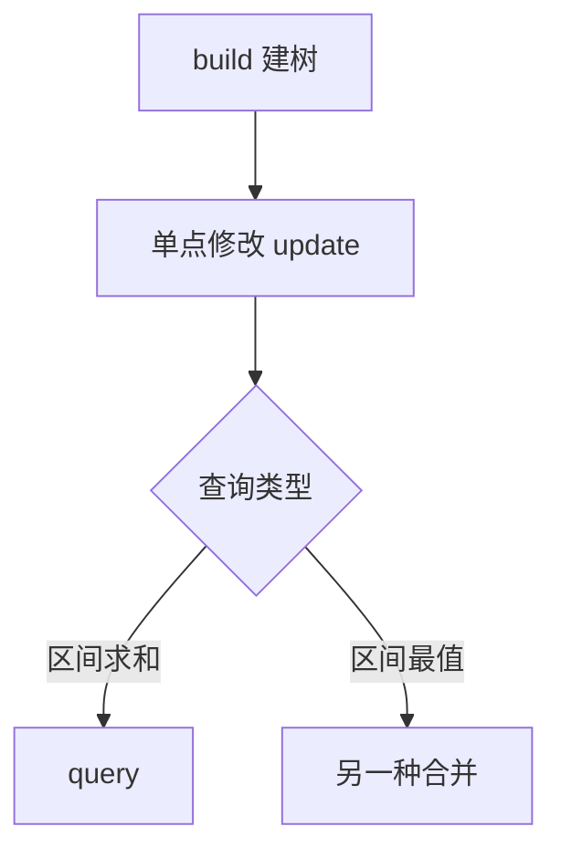

线段树（segment tree）把区间拆成一棵二叉树，每个节点维护一段区间的聚合值。
本文以「单点修改 + 区间求和」为例，把 C++ 与 Rust 两版实现并排放在一起对照。

<!--more-->

## 结构定义

设数组下标从 $1$ 开始，节点 $u$ 维护区间 $[l, r]$，左右儿子分别是
$2u$ 和 $2u+1$，则区间求和满足

$$
\text{sum}(u) = \text{sum}(2u) + \text{sum}(2u + 1)
$$

建树的时间复杂度为 $O(n)$，因为每个节点只被访问一次：

$$
T(n) = 2T\left(\frac{n}{2}\right) + O(1) = O(n)
$$

## 两版实现并排对照

同一个算法的两种语言实现，并排看更清楚：



const int MAXN = 1e5 + 5;
long long sum[MAXN << 2];
int n, a[MAXN];

void build(int u, int l, int r) {
    if (l == r) { sum[u] = a[l]; return; }
    int mid = (l + r) >> 1;
    build(u << 1, l, mid);
    build(u << 1 | 1, mid + 1, r);
    sum[u] = sum[u << 1] + sum[u << 1 | 1];
}

void update(int u, int l, int r, int pos, int val) {
    if (l == r) { sum[u] = val; return; }
    int mid = (l + r) >> 1;
    if (pos <= mid) update(u << 1, l, mid, pos, val);
    else            update(u << 1 | 1, mid + 1, r, pos, val);
    sum[u] = sum[u << 1] + sum[u << 1 | 1];
}

long long query(int u, int l, int r, int ql, int qr) {
    if (ql <= l && r <= qr) return sum[u];
    int mid = (l + r) >> 1;
    long long res = 0;
    if (ql <= mid) res += query(u << 1, l, mid, ql, qr);
    if (qr >  mid) res += query(u << 1 | 1, mid + 1, r, ql, qr);
    return res;
}


const MAXN: usize = 100_005;

struct SegTree {
    sum: Vec<i64>,
    n: usize,
}

impl SegTree {
    fn new(a: &[i64]) -> Self {
        let n = a.len() - 1;
        let mut t = SegTree { sum: vec![0; MAXN << 2], n };
        t.build(1, 1, n, a);
        t
    }

    fn build(&mut self, u: usize, l: usize, r: usize, a: &[i64]) {
        if l == r { self.sum[u] = a[l]; return; }
        let mid = (l + r) >> 1;
        self.build(u << 1, l, mid, a);
        self.build(u << 1 | 1, mid + 1, r, a);
        self.sum[u] = self.sum[u << 1] + self.sum[u << 1 | 1];
    }

    fn update(&mut self, u: usize, l: usize, r: usize, pos: usize, val: i64) {
        if l == r { self.sum[u] = val; return; }
        let mid = (l + r) >> 1;
        if pos <= mid { self.update(u << 1, l, mid, pos, val); }
        else          { self.update(u << 1 | 1, mid + 1, r, pos, val); }
        self.sum[u] = self.sum[u << 1] + self.sum[u << 1 | 1];
    }

    fn query(&self, u: usize, l: usize, r: usize, ql: usize, qr: usize) -> i64 {
        if ql <= l && r <= qr { return self.sum[u]; }
        let mid = (l + r) >> 1;
        let mut res = 0;
        if ql <= mid { res += self.query(u << 1, l, mid, ql, qr); }
        if qr > mid  { res += self.query(u << 1 | 1, mid + 1, r, ql, qr); }
        res
    }
}



## 复杂度

| 操作 | 时间复杂度 | 说明 |
| --- | --- | --- |
| 建树 | $O(n)$ | 每个节点访问一次 |
| 单点修改 | $O(\log n)$ | 从根走到叶子 |
| 区间查询 | $O(\log n)$ | 最多覆盖 $O(\log n)$ 个整段 |

## 标签页模式

同一段代码如果要加注释版，也可以做成标签页：



int query(int u, int l, int r, int ql, int qr) {
    if (ql <= l && r <= qr) return sum[u];
    int mid = (l + r) >> 1; long long res = 0;
    if (ql <= mid) res += query(u << 1, l, mid, ql, qr);
    if (qr >  mid) res += query(u << 1 | 1, mid + 1, r, ql, qr);
    return res;
}


// u: 当前节点；[l, r]: 当前节点维护的区间；[ql, qr]: 询问区间
int query(int u, int l, int r, int ql, int qr) {
    // 当前区间被询问区间完全包含，直接返回，不再递归
    if (ql <= l && r <= qr) return sum[u];
    int mid = (l + r) >> 1;
    long long res = 0;
    // 左半边有交集才递归，避免无谓的访问
    if (ql <= mid) res += query(u << 1, l, mid, ql, qr);
    if (qr >  mid) res += query(u << 1 | 1, mid + 1, r, ql, qr);
    return res;
}



## 带文件名的代码块

代码块上加 `{title="..."}` 就能显示文件名栏：

```cpp {title="main.cpp" linenos=true}
int main() {
    scanf("%d", &n);
    for (int i = 1; i <= n; i++) scanf("%d", &a[i]);
    build(1, 1, n);
    update(1, 1, n, 3, 7);
    printf("%lld\n", query(1, 1, n, 2, 5));
    return 0;
}
```

## 调用链



## 易错点

- 数组要开到 $4n$，不是 $2n$：节点编号最坏会到 $4n-1$
- 递归边界写 `l == r` 而不是 `l >= r`，否则空区间会无限递归
- `mid` 用 `(l + r) >> 1` 而不是 `(l + r) / 2`，负数区间下二者行为不同
