本来是打算按顺序来的，想了想还是先上 PIEMM 最喜欢的三个：并查集、线段树、平衡树。都写最普通的版本，变种以后另开篇。三道题全是洛谷模板题：[P3367](https://www.luogu.com.cn/problem/P3367)、[P3372](https://www.luogu.com.cn/problem/P3372)、[P3369](https://www.luogu.com.cn/problem/P3369)。

## 并查集（P3367）

n 个元素，反复合并集合、问两个人是不是一伙的。每个元素只记一件事：**父亲是谁**。每个根再多记一个数，这伙有多少人。查询就顺着父亲一路爬到根，根一样就是同伙；合并的时候把小的那伙挂到大的下面。

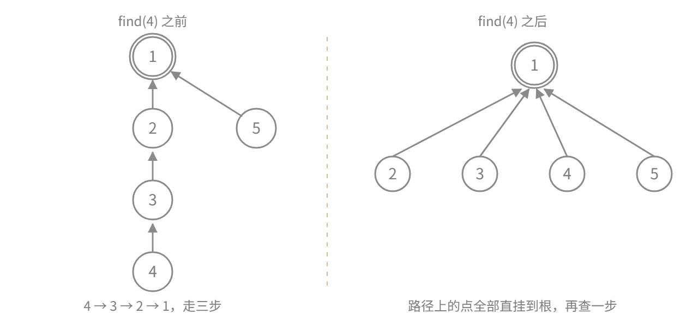

```cpp
#include <iostream>
using namespace std;

const int N = 10010;
int fa[N];
int sz[N];

void init(int n) {
    for (int i = 1; i <= n; i++) {
        fa[i] = i;
        sz[i] = 1;
    }
}

int find(int x) {
    return fa[x] == x ? x : fa[x] = find(fa[x]);
}

void merge(int x, int y) {
    int fx = find(x);
    int fy = find(y);
    if (fx == fy) return;

    if (sz[fx] < sz[fy]) swap(fx, fy);

    fa[fy] = fx;
    sz[fx] += sz[fy];
}

bool same(int x, int y) {
    return find(x) == find(y);
}

int main() {
    int n, m;
    cin>>n>>m;
    init(n);
    while (m--) {
        int op, x, y;
        cin>>op>>x>>y;
        if (op == 1) merge(x,y);
        else cout << (same(x,y) ? "Y" : "N") << endl;
    }
    return 0;
}
```

| 函数 | 干的事 |
|---|---|
| `init` | `fa[i] = i`、`sz[i] = 1`，各人自成一家 |
| `find` | 一路爬到根，路上经过的点顺手挂到根上 |
| `merge` | 两个根不同才合；`sz` 小的挂到大的下面，大小加过去 |
| `same` | 两个根相等就是同伙 |

`merge` 里第一行 `fa[fy] = fx`，等号两边都得是根。写成 `fa[x] = fa[y]` 就把树拆散了。谁挂谁不看传参的顺序，而是`sz` 说了算，那行 `swap` 保证小树挂大树。去掉它、按输入的顺序乱挂，可能会成一条链，速度会很慢。

路径压缩压过的路不会再走第二遍，按大小合并，每挂一次小树那头至少翻倍，最多翻 log n 次，树高就压在 log n 以内。两个一起上，均摊 O(α(n))，α 是反阿克曼函数，这个规模下就是个常数。只留一个的话，都还停在 log 级。

## 线段树（P3372）

一串数，无非两件事：对某一整段做同一个操作，问某一整段的结果。加一个数、整段赋值、取最大值，都算。暴力得把段里元素挨个扫，m 次操作 O(nm)。线段树把这些段做成一个个能整体处理的单位，一次算一段。

做法是把 [1, n] 对半切开，一直切到单点，得到一棵树，每个节点管一段。后面所有操作都靠两条性质撑着。一条是任意区间都能用 O(log n) 个现成节点拼出来，叫区间分解；另一条是被整段覆盖的节点只记账、不往下算，等真要用儿子了再还，叫懒标记。

还有个前提：两个子区间的答案得能合并。加法能和成和，max 取大的那个，区间翻转能拼回来；「区间众数」就凑不出来，那东西合并不了。

P3372 要的是加法这版。下图是 [1, 8] 建出来的树，方框里写着每个节点管哪一段。查 [3, 6]，只有 [3,4] 和 [5,6] 被整段命中，别的分支在递归里直接被剪掉。所谓「拆成对数个节点」，拆的就是这一小段一小段。

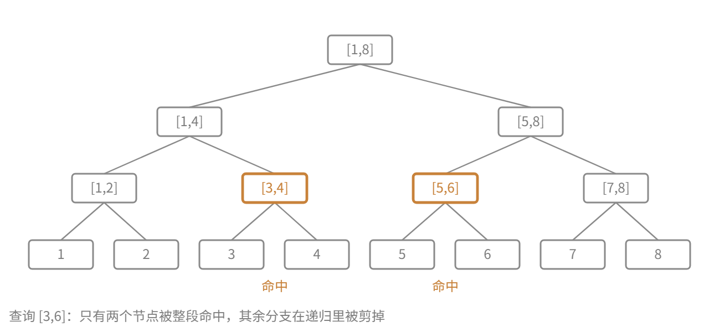

```cpp
#include <iostream>
using namespace std;
typedef long long ll;

const int N = 1e5 + 10;
ll a[N], tr[N * 4], lazy[N * 4];

void pushup(int u) {
    tr[u] = tr[u * 2] + tr[u * 2 + 1];
}

void pushdown(int u, int l, int r) {
    if (!lazy[u]) return;
    int mid = (l + r) / 2;
    tr[u * 2] += lazy[u] * (mid - l + 1);
    tr[u * 2 + 1] += lazy[u] * (r - mid);
    lazy[u * 2] += lazy[u];
    lazy[u * 2 + 1] += lazy[u];
    lazy[u] = 0;
}

void build(int u, int l, int r) {
    if (l == r) { tr[u] = a[l]; return; }
    int mid = (l + r) / 2;
    build(u * 2, l, mid);
    build(u * 2 + 1, mid + 1, r);
    pushup(u);
}

void update(int u, int l, int r, int ql, int qr, ll val) {
    if (ql <= l && r <= qr) {
        tr[u] += val * (r - l + 1);
        lazy[u] += val;
        return;
    }
    pushdown(u, l, r);
    int mid = (l + r) / 2;
    if (ql <= mid) update(u * 2, l, mid, ql, qr, val);
    if (qr > mid) update(u * 2 + 1, mid + 1, r, ql, qr, val);
    pushup(u);
}

ll query(int u, int l, int r, int ql, int qr) {
    if (ql <= l && r <= qr) return tr[u];
    pushdown(u, l, r);
    int mid = (l + r) / 2;
    ll res = 0;
    if (ql <= mid) res += query(u * 2, l, mid, ql, qr);
    if (qr > mid) res += query(u * 2 + 1, mid + 1, r, ql, qr);
    return res;
}

int main() {
    int n, m;
    cin >> n >> m;
    for (int i = 1; i <= n; i++) cin >> a[i];
    build(1, 1, n);
    while (m--) {
        int op, x, y;
        ll k;
        cin >> op;
        if (op == 1) {
            cin >> x >> y >> k;
            update(1, 1, n, x, y, k);
        } else {
            cin >> x >> y;
            cout << query(1, 1, n, x, y) << endl;
        }
    }
    return 0;
}
```

| 函数 | 干的事 |
|---|---|
| `pushup` | 儿子算完，把答案合并给父亲——这里就是求和 |
| `pushdown` | 父亲欠的账还给儿子，还完清 `lazy[u]` |
| `build` | 递归到叶子灌 `a[l]`，回来一路 `pushup` |
| `update` | 整段覆盖就改 `tr[u]` 顺手记 `lazy[u]`；否则先把标记推下去，再往有交集的儿子递归 |
| `query` | 整段覆盖直接返回 `tr[u]`；否则先 `pushdown`，再把有交集的儿子加起来 |

一次 `update` 就这么走：整段被盖住的节点当场改值、顺手记一笔，路上的节点都只是路过，回到根再把儿子的答案合上来。

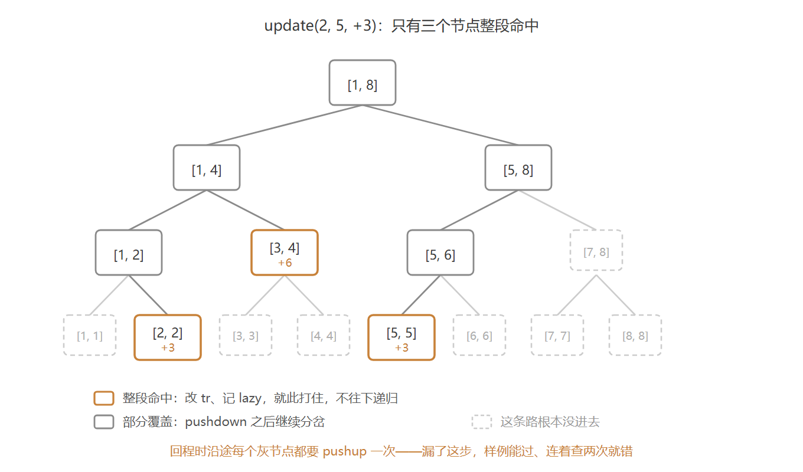

这段单独拎出来，对着图上那条路看：

```cpp
void update(int u, int l, int r, int ql, int qr, ll val) {
    if (ql <= l && r <= qr) {
        tr[u] += val * (r - l + 1);
        lazy[u] += val;
        return;
    }
    pushdown(u, l, r);
    int mid = (l + r) / 2;
    if (ql <= mid) update(u * 2, l, mid, ql, qr, val);
    if (qr > mid) update(u * 2 + 1, mid + 1, r, ql, qr, val);
    pushup(u);
}
```

懒标记是这块最绕的地方，单独说。整段被盖住时只改根、记一笔，两个儿子还是旧值；等真要走进去，才把这一笔推下去一次。

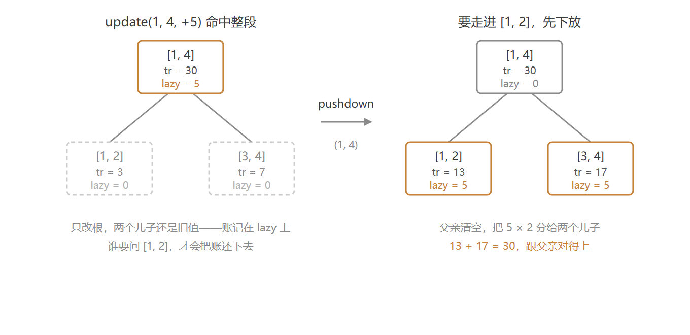

推下去的动作就是 `pushdown` 这九行：

```cpp
void pushdown(int u, int l, int r) {
    if (!lazy[u]) return;
    int mid = (l + r) / 2;
    tr[u * 2] += lazy[u] * (mid - l + 1);
    tr[u * 2 + 1] += lazy[u] * (r - mid);
    lazy[u * 2] += lazy[u];
    lazy[u * 2 + 1] += lazy[u];
    lazy[u] = 0;
}
```

`tr` 和 `lazy` 开四倍。真实节点只有 2n−1 个——可堆式下标 `2u`、`2u+1` 在 n 不是 2 的幂时，最深一层能摸到 4n 附近。开 2n 就是等着越界（这题 n 是 1e5，4n 摊下来也就 6 MB）。

一些要注意的地方，也都是刚开始写的时候容易出错的，现在基本不会了：

- 整段覆盖时 `tr[u] += val * len` 和 `lazy[u] += val` 两行都得写，少一行就错
- 加法标记能累加，+5 再 -3 就是 +2，一个变量够用。换成整段赋值就不行了，赋值不能累加，`lazy` 的语义得整个换掉，这就是「区间赋值线段树」为什么要单独写
- 开 `long long`。1e5 个数每个 1e9、加 1e5 次，和到 1e14，`int` 直接爆

每次修改或查询只在「部分覆盖」的节点往下递归，每层最多两个，左右端点各挂一个。树深 log₂n，所以是 O(log n)。建树每个节点走一次，O(n)。空间是两个 4n 的 `long long` 数组，6 MB 出头。

## 平衡树（P3369）

六件事：插入、删除、查排名、查第 k 小、查前驱、查后继，全要 O(log n)。能一手全包的只有平衡树。

这里用 **FHQ-Treap**，也就是无旋 Treap。两个核心操作拼出六件事：`split(u, val)` 按权值把树拆成两棵，一棵全 ≤ val、一棵全 > val；`merge(x, y)` 把两棵合回去，前提是 x 里所有值都不大于 y 里的。

图里每个方框两行，上面权值 `val`，下面随机优先级 `key`。两条序同时成立：中序读出来 `val` 是 20 30 45 50 70，左小右大，这是 BST 的序；`key` 从上往下递增，父小于子，这是堆的序。45 那个位置记一下，它是 30 的右儿子，却比祖父 50 还小。按 40 切的时候它就守不住了，会被切到 50 那边。

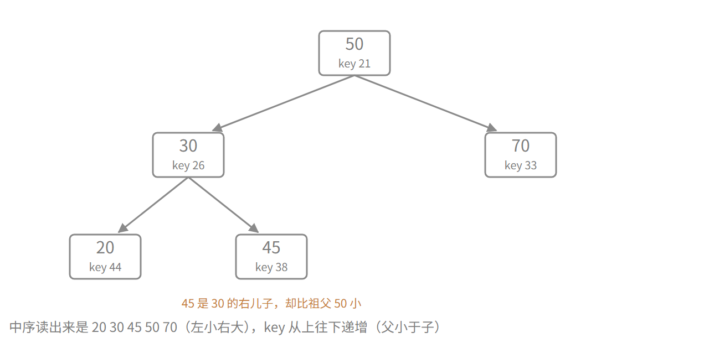

```cpp
#include<iostream>
#include<random>
#include<ctime>
using namespace std;

const int N = 1e5 + 10;

struct Node {
    int l, r;
    int val;
    int key;
    int sz;
} tr[N];

int root;
int tot;

int newNode(int val) {
    ++tot;
    tr[tot].l = tr[tot].r = 0;
    tr[tot].val = val;
    tr[tot].key = rand();
    tr[tot].sz = 1;
    return tot;
}

void pushup(int u) {
    tr[u].sz = tr[tr[u].l].sz + tr[tr[u].r].sz + 1;
}

void split(int u, int val, int &x, int &y) {
    if (!u) {
        x = y = 0;
        return;
    }
    if (tr[u].val <= val) {
        x = u;
        split(tr[u].r, val, tr[u].r, y);
    } else {
        y = u;
        split(tr[u].l, val, x, tr[u].l);
    }
    pushup(u);
}

int merge(int x, int y) {
    if (!x || !y) return x | y;
    if (tr[x].key < tr[y].key) {
        tr[x].r = merge(tr[x].r, y);
        pushup(x);
        return x;
    } else {
        tr[y].l = merge(x, tr[y].l);
        pushup(y);
        return y;
    }
}

void insert(int val) {
    int x, y;
    split(root, val, x, y);
    root = merge(merge(x, newNode(val)), y);
}

void erase(int val) {
    int x, y, z;
    split(root, val, x, z);
    split(x, val - 1, x, y);
    y = merge(tr[y].l, tr[y].r);
    root = merge(merge(x, y), z);
}

int getRank(int val) {
    int x, y;
    split(root, val - 1, x, y);
    int ans = tr[x].sz + 1;
    root = merge(x, y);
    return ans;
}

int getKth(int u, int k) {
    while (true) {
        int leftSz = tr[tr[u].l].sz;
        if (k <= leftSz) {
            u = tr[u].l;
        } else if (k == leftSz + 1) {
            return tr[u].val;
        } else {
            k -= leftSz + 1;
            u = tr[u].r;
        }
    }
}

int getPre(int val) {
    int x, y;
    split(root, val - 1, x, y);
    int ans = -1;
    if (x) {
        int u = x;
        while (tr[u].r) u = tr[u].r;
        ans = tr[u].val;
    }
    root = merge(x, y);
    return ans;
}

int getNext(int val) {
    int x, y;
    split(root, val, x, y);
    int ans = -1;
    if (y) {
        int u = y;
        while (tr[u].l) u = tr[u].l;
        ans = tr[u].val;
    }
    root = merge(x, y);
    return ans;
}

int main() {
    ios::sync_with_stdio(false);
    cin.tie(nullptr);

    srand(time(nullptr));

    int n;
    cin >> n;

    while (n--) {
        int op, x;
        cin >> op >> x;

        if (op == 1) {
            insert(x);
        } else if (op == 2) {
            erase(x);
        } else if (op == 3) {
            cout << getRank(x) << '\n';
        } else if (op == 4) {
            cout << getKth(root, x) << '\n';
        } else if (op == 5) {
            cout << getPre(x) << '\n';
        } else {
            cout << getNext(x) << '\n';
        }
    }

    return 0;
}
```
| 函数 | 干的事 |
|---|---|
| `newNode` | 开一个新节点，`key = rand()`，`sz = 1` |
| `pushup` | `sz = 左 sz + 右 sz + 1`；0 号是空节点，`sz` 天然为 0，不用特判 |
| `split` | 按 `val` 拆：`≤ val` 归 x，`> val` 归 y。每层只往一个儿子递归，靠引用参数 `int &x, int &y` 把两棵树回填给调用者 |
| `merge` | 比 `key`，小的当根；再把另一棵递归塞进它的空位。 |
| `insert` | 拆成两棵 → 新节点单独一棵 → 三次 `merge` 夹回中间 |
| `erase` | 拆两次，中间那棵就是所有等于 val 的节点；扔掉它的根（左右儿子 merge 起来），剩下拼回去。 |
| `getRank` | 按 `val - 1` 拆，x 里全是严格小于 val 的，排名就是 `tr[x].sz + 1` |
| `getKth` | 不拆树，比左子树大小一路往下走 |
| `getPre` / `getNext` | 拆出半边，往右（左）走到端点 |

`getRank`、`getPre`、`getNext` 都会动树：先用 `split` 拆开，问完再用 `merge` 拼回去。

`split` 这个操作，我感觉用文字描述不如直接看图。写法就是从根往下走，每层把当前结点归到 x 或 y 一侧，剩下的子树整块跟着走，走到空就停，两棵树自己就长好了。

这儿拆的是 `split(root, 40)`。40 本身不在树上，它只是条界，正好落在 30 和 45 之间，也就是图里那条虚线。从根往下走：50 在界右边，归 y；30 在界左边，归 x；再走到 30 的右子树，45 还在界右边，也归 y。

45 这么一归，就从 30 的右儿子变成了 50 的左儿子。**切的是权值，不是位置**——一条边断了，下面整块跟着走，结点自然就换了父亲。

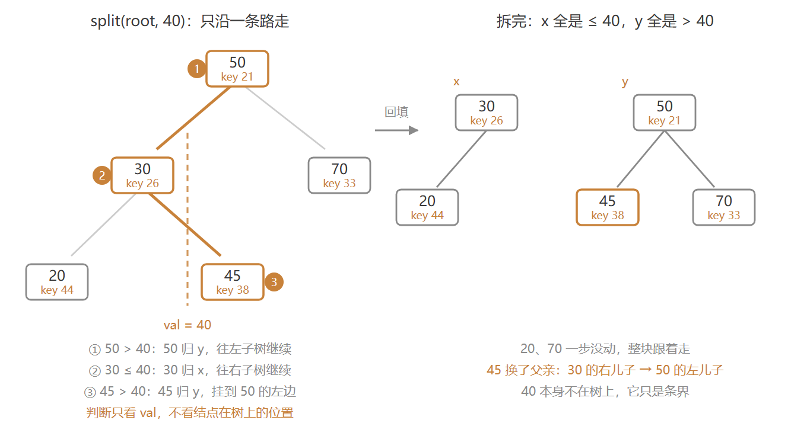

代码就两条分支，一条往右、一条往左：

```cpp
void split(int u, int val, int &x, int &y) {
    if (!u) {
        x = y = 0;
        return;
    }
    if (tr[u].val <= val) {
        x = u;
        split(tr[u].r, val, tr[u].r, y);
    } else {
        y = u;
        split(tr[u].l, val, x, tr[u].l);
    }
    pushup(u);
}
```

`merge` 的取舍就一句话：两个根比 `key`，小的当根，另一棵整棵挂到它的空位上即可。

拿它把上面拆开的两棵合回去，正好还是原来那棵树。也很容易看出来，`split` 和 `merge` 是互逆的。

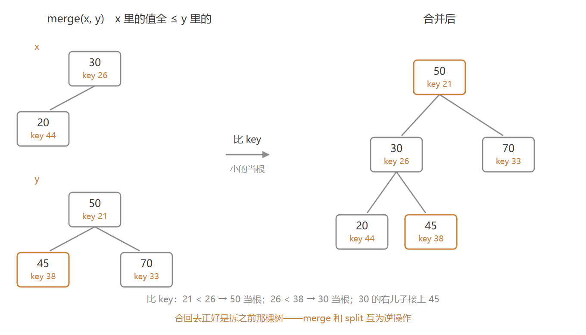

```cpp
int merge(int x, int y) {
    if (!x || !y) return x | y;
    if (tr[x].key < tr[y].key) {
        tr[x].r = merge(tr[x].r, y);
        pushup(x);
        return x;
    } else {
        tr[y].l = merge(x, tr[y].l);
        pushup(y);
        return y;
    }
}
```

两个地方值得记：

- 树形由 `srand(time(nullptr))` 决定。删掉这行，`rand()` 每次跑出同一串数，树形固定，代价是这棵树不算真随机
- `N` 按操作数开，不按值域——值域到 1e7，开不下。每 `insert` 一次就 `++tot`，插重复值也照样开新点，1e5 次操作最多用掉 1e5 个点

`key` 随机，等于把这堆数按随机顺序插进一棵普通 BST。

而 `split` 和 `merge` 每层只往一个儿子走，走到空就停——一次操作翻过的层数，最多也就是树高。树高是 log 级，而每个操作不过是几次 `split`、`merge`，所以六个操作都成了期望 O(log n)。

**期望**只管平均，不管最坏。要让树退化成链，得 n 个随机 `key` 恰好按 `val` 的顺序排好，概率是 **n! 分之一**，说明这事几乎不可能发生。

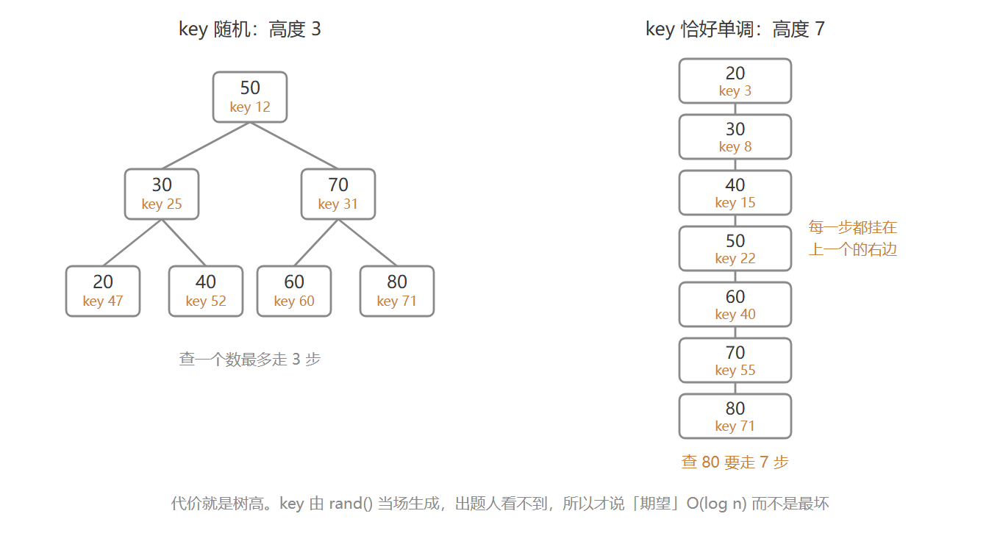

### Splay：不靠随机，靠访问

看完 FHQ，来看看 Splay 吧。FHQ 的平衡是赌出来的：`key` 生成完，树形就定死了，之后一动不动。Splay 不掷骰子，它把每次碰过的结点旋到根——树长什么样，取决于你碰它的方式。

碰过的点就在根上，下次再碰它一步就到。可搬它上来这一趟不便宜：埋得越深，转的次数越多，单次能慢到 O(n)。搬过之后，那条路上的点都往上挪了，下次再走就短。这笔账得合起来算——一次可能很贵，一长串摊下来是 O(log n)。

同一道题（P3369），整份代码：

```cpp
#include<iostream>
using namespace std;

const int N = 1e5 + 10;
const int INF = 1e9;

int n, root, tot;

struct Node {
    int ch[2];
    int fa;
    int val;
    int cnt;
    int sz;
} tr[N];

void pushup(int x) {
    tr[x].sz = tr[tr[x].ch[0]].sz + tr[tr[x].ch[1]].sz + tr[x].cnt;
}

int get(int x) {
    return tr[tr[x].fa].ch[1] == x;
}

void rotate(int x) {
    int y = tr[x].fa;
    int z = tr[y].fa;
    int k = get(x);

    tr[y].ch[k] = tr[x].ch[k ^ 1];
    if (tr[x].ch[k ^ 1]) tr[tr[x].ch[k ^ 1]].fa = y;

    tr[x].fa = z;
    if (z) tr[z].ch[get(y)] = x;

    tr[x].ch[k ^ 1] = y;
    tr[y].fa = x;

    pushup(y);
    pushup(x);
}

void splay(int x, int goal = 0) {
    while (tr[x].fa != goal) {
        int y = tr[x].fa;
        int z = tr[y].fa;

        if (z != goal) {
            if (get(x) == get(y)) rotate(y);
            else rotate(x);
        }
        rotate(x);
    }
    if (goal == 0) root = x;
}

void find(int val) {
    int x = root;
    if (!x) return;
    while (tr[x].ch[val > tr[x].val] && val != tr[x].val) {
        x = tr[x].ch[val > tr[x].val];
    }
    splay(x);
}

void insert(int val) {
    if (!root) {
        root = ++tot;
        tr[root].val = val;
        tr[root].cnt = 1;
        tr[root].sz = 1;
        return;
    }

    int x = root, fa = 0;
    while (true) {
        if (tr[x].val == val) {
            tr[x].cnt++;
            pushup(x);
            splay(x);
            return;
        }
        fa = x;
        int d = val > tr[x].val;
        x = tr[x].ch[d];
        if (!x) {
            tr[++tot].val = val;
            tr[tot].cnt = 1;
            tr[tot].sz = 1;
            tr[tot].fa = fa;
            tr[fa].ch[d] = tot;
            pushup(fa);
            splay(tot);
            return;
        }
    }
}

void erase(int val) {
    find(val);
    if (tr[root].val != val) return;

    if (tr[root].cnt > 1) {
        tr[root].cnt--;
        pushup(root);
        return;
    }

    if (!tr[root].ch[0] && !tr[root].ch[1]) {
        root = 0;
        return;
    }
    if (!tr[root].ch[0]) {
        root = tr[root].ch[1];
        tr[root].fa = 0;
        return;
    }
    if (!tr[root].ch[1]) {
        root = tr[root].ch[0];
        tr[root].fa = 0;
        return;
    }

    int oldRight = tr[root].ch[1];
    int x = tr[root].ch[0];
    while (tr[x].ch[1]) x = tr[x].ch[1];
    splay(x);
    tr[oldRight].fa = x;
    tr[x].ch[1] = oldRight;
    pushup(x);
}

int getRank(int val) {
    find(val);
    if (tr[root].val >= val) {
        return tr[tr[root].ch[0]].sz + 1;
    } else {
        return tr[tr[root].ch[0]].sz + tr[root].cnt + 1;
    }
}

int getKth(int k) {
    int x = root;
    while (true) {
        int leftSz = tr[tr[x].ch[0]].sz;
        if (k <= leftSz) {
            x = tr[x].ch[0];
        } else if (k <= leftSz + tr[x].cnt) {
            splay(x);
            return tr[x].val;
        } else {
            k -= leftSz + tr[x].cnt;
            x = tr[x].ch[1];
        }
    }
}
int getPre(int val) {
    find(val);
    if (tr[root].val < val) return root;
    int x = tr[root].ch[0];
    if (!x) return 0;
    while (tr[x].ch[1]) x = tr[x].ch[1];
    return x;
}
int getNext(int val) {
    find(val);
    if (tr[root].val > val) return root;
    int x = tr[root].ch[1];
    if (!x) return 0;
    while (tr[x].ch[0]) x = tr[x].ch[0];
    return x;
}

int main() {
    ios::sync_with_stdio(false);
    cin.tie(nullptr);

    cin>>n;

    insert(-INF);
    insert(INF);

    while (n--) {
        int op, x;
        cin>>op>>x;

        if (op == 1) {
            insert(x);
        } else if (op == 2) {
            erase(x);
        } else if (op == 3) {
            cout<<getRank(x) - 1<<'\n';
        } else if (op == 4) {
            cout<<getKth(x + 1)<<'\n';
        } else if (op == 5) {
            cout<<tr[getPre(x)].val<<'\n';
        } else {
            cout<<tr[getNext(x)].val<<'\n';
        }
    }

    return 0;
}
```

| 函数 | 干的事 |
|---|---|
| `pushup` / `get` | `sz = 左 + 右 + cnt`；`get` 返回 x 在父亲的哪一边，右儿子为 1 |
| `rotate` | 把 x 上提一层、顶掉父亲的位置 |
| `splay` | 一路旋到 `goal` 的儿子位置；同侧先转父亲，异侧先转自己 |
| `find` | 按 `val` 顺 BST 走到那个点，再把终点旋到根 |
| `insert` | 值重复就 `cnt++`，否则新点挂在叶子上；两种情况最后都 splay 到根 |
| `erase` | 先 `find` 旋到根，再按副本数、左右儿子有无分四路 |
| `getRank` | `find` 之后读根左子树的大小，根不比 `val` 小就 `+1`，否则再加 `cnt` |
| `getKth` | 不拆树，比左子树大小一路往下，命中就 `splay` |
| `getPre` / `getNext` | `find` 之后看根合不合用，不合就往左（右）子树走到底 |

`sz` 那行的 `+ cnt` 最容易漏。同一个值不重复开结点，插第二次、第三次只是把方框里的 `cnt` 加一，随后照样 `splay` 到根。树形会动，结点数不变。所以**`sz` 数的是元素个数，不是方框个数**。`getRank` 里的 `+ tr[root].cnt`、`getKth` 里的 `leftSz + tr[x].cnt`，也都是这个事。

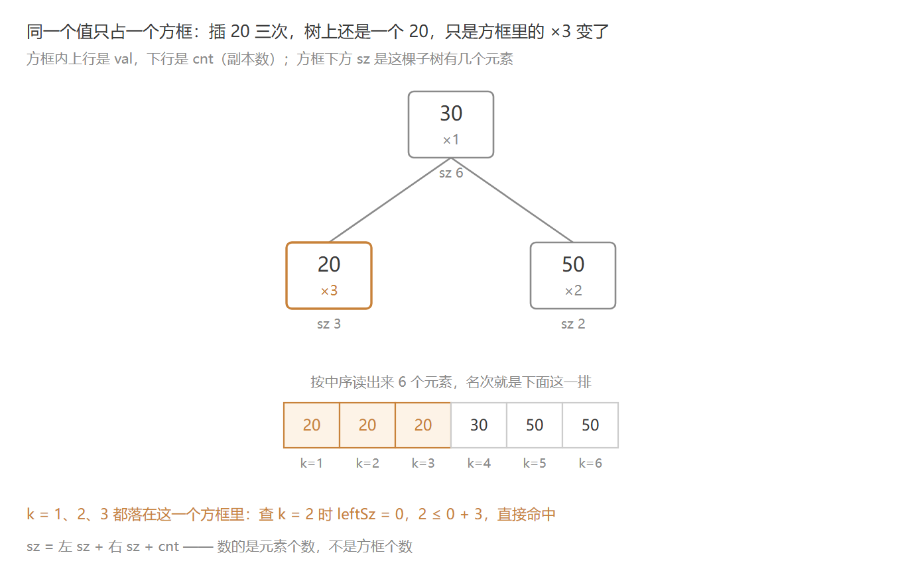

#### 转：一个函数，两个方向

节点比 FHQ 多一个 `fa`，因为它得往上走。整套东西只有一个基本动作：转。把 x 提一层，替掉它父亲的位置，动到的只有跟它相连的三条边，剩下的整块跟着走。

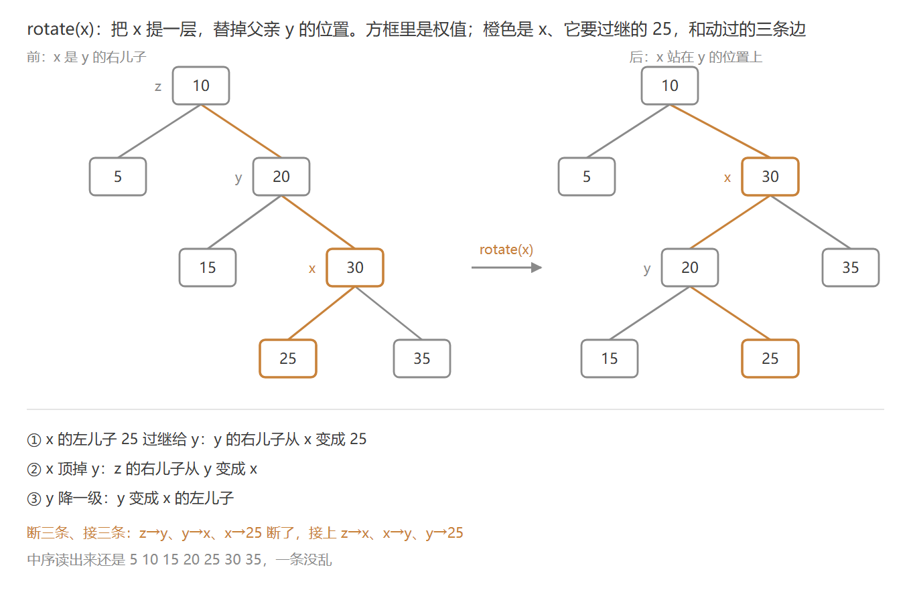

```cpp
void rotate(int x) {
    int y = tr[x].fa;
    int z = tr[y].fa;
    int k = get(x);

    tr[y].ch[k] = tr[x].ch[k ^ 1];
    if (tr[x].ch[k ^ 1]) tr[tr[x].ch[k ^ 1]].fa = y;

    tr[x].fa = z;
    if (z) tr[z].ch[get(y)] = x;

    tr[x].ch[k ^ 1] = y;
    tr[y].fa = x;

    pushup(y);
    pushup(x);
}
```

这个函数没有分支：过继、认爷爷、降儿子，三步每次都走。

`k = get(x)` 是 0 就右旋，是 1 就左旋，简洁有效。

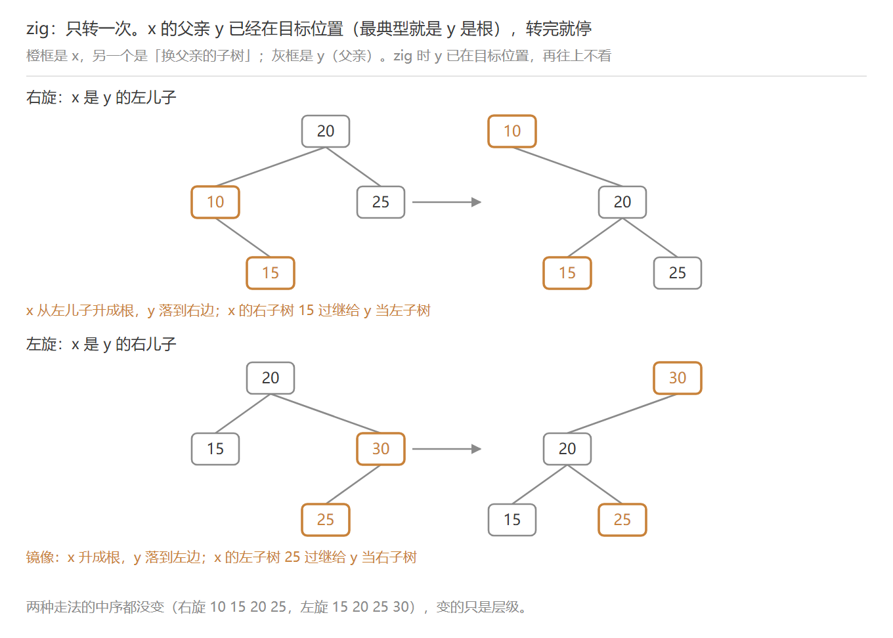

要往上提两层，就得转两次。第一次转完 x 顶掉 y，第二次往哪转，看 x 相对 z 站哪边。`get(x)`、`get(y)` 各取 0 或 1，凑出四种组合——落到 `splay` 里只分两类。

#### 走法：同侧与异侧

`get` 是「相对自己父亲站哪边」，0 左 1 右。`get(x) == get(y)` 是同侧，不等是异侧——同侧一直往一边走，异侧中途拐回来。

##### 同侧：先转父亲

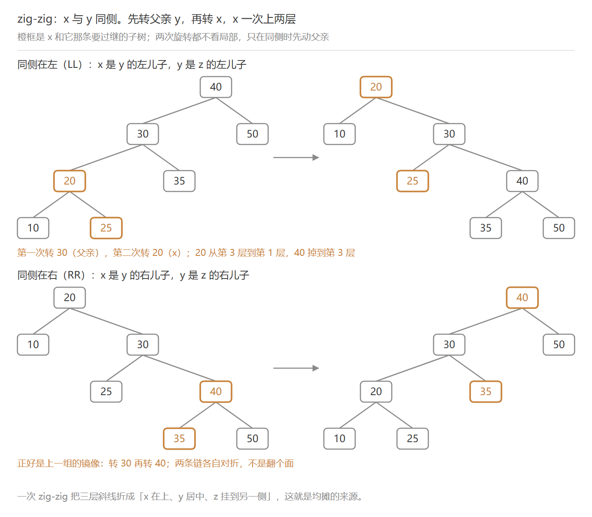

`rotate(y); rotate(x);`——两次同向，转完 x 站到 z 的位置，跨两层。

##### 异侧：连转自己

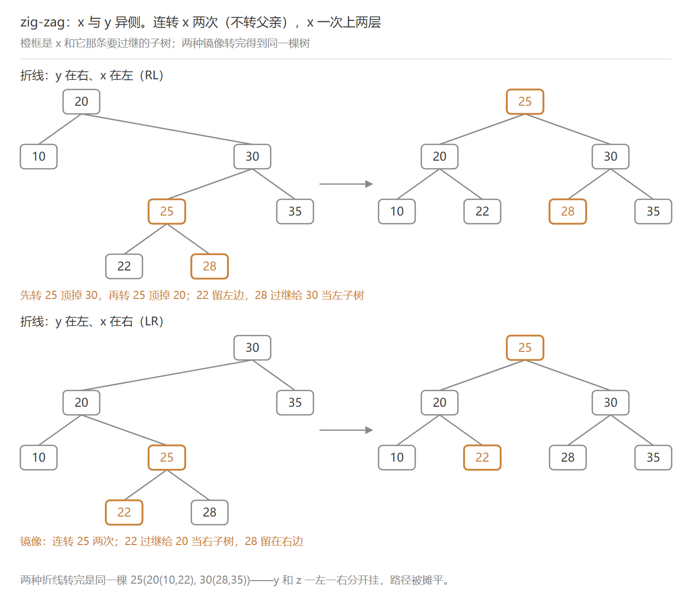

`rotate(x); rotate(x);`——两次反向，x 先顶 y 的位置，再顶 z 的位置。

##### 收尾：只剩单旋

`while` 的最后一圈，z 已经等于 `goal` 了，旋到根时 `goal` 取 0，没有祖父可看，只剩一次 `rotate(x)`，就是上面 zig 那种单旋。

三种走法全在这几行里：

```cpp
void splay(int x, int goal = 0) {
    while (tr[x].fa != goal) {
        int y = tr[x].fa;
        int z = tr[y].fa;

        if (z != goal) {
            if (get(x) == get(y)) rotate(y);
            else rotate(x);
        }
        rotate(x);
    }
    if (goal == 0) root = x;
}
```

`z == goal` 时外层 `if` 整块跳过，只剩末尾那次 `rotate(x)`——这就是 zig；`get(x) == get(y)` 走 zig-zig；`else` 走 zig-zag。三种走法的差别，全在 `if` 这一行。

查询走的是 `find`：从根顺着 BST 往下，找到就停，再把它旋到根。

```cpp
void find(int val) {
    int x = root;
    if (!x) return;
    while (tr[x].ch[val > tr[x].val] && val != tr[x].val) {
        x = tr[x].ch[val > tr[x].val];
    }
    splay(x);
}
```

实现上还有一处跟 FHQ 不同。`main` 里先插了 `-INF` 和 `INF` 两个哨兵，所以 `op == 3` 要输出 `getRank(x) - 1`，`op == 4` 要传 `x + 1`，前驱后继倒是永远有得返回。哨兵省掉了「找不到怎么办」的分支，代价就是这两处有错位。

两版摆一起：

| | FHQ-Treap | Splay |
|---|---|---|
| 平衡靠什么 | 随机 `key`，树形建好就定死 | 每次访问旋到根，树形一直在变 |
| 核心动作 | `split` + `merge` | `rotate` + `splay` |
| 保证 | 期望 O(log n)，数据猜不到 `key` | 均摊 O(log n)，单次可能 O(n) |
| 顺手能干什么 | 可持久化 | LCT |

## 三样的复杂度对比

三个的每次操作都压在 log 以内，可快的原因完全不同，翻车的方式也跟着不同。

| | 并查集 | 线段树 | 平衡树 |
|---|---|---|---|
| 单次操作 | 均摊 O(α(n)) | O(log n) | 期望 / 均摊 O(log n) |
| 最坏情况 | O(log n)：树高被 `sz` 卡住 | O(log n) | 单次 O(n)：key 单调，或访问序列刻意卡 |
| 初始化 | O(n) | O(n) 建树 | 无 |
| 空间 | O(n) | O(n)，数组要开 4n | O(n)，池按插入次数算 |
| log 从哪来 | 没有 log——`sz` 把树高压到 log，压缩把重复的路摊成常数 | 划分——区间拆成对数个节点 | 随机（FHQ 的 key）或自适应（Splay 往根上旋） |

并查集是摊还，单次仍可能走一趟长路，总账不亏。线段树是划分，每次都有保证，代价是常数大、代码也长。平衡树这一列是两种活法：FHQ 把平衡押在看不见的 `key` 上，Splay 则赌刚用过的还会再用，两个都没有单次保证。

## 三样怎么选

| 需求 | 用什么 |
|---|---|
| 合并两伙人，问是不是同一伙 | 并查集 |
| 一段上整体操作，问这一整段的和、最小值或最大值 | 线段树 |
| 这堆数里第 k 小是谁、某个数排第几、前驱后继 | 平衡树 |

总结就一句话：**线段树擅长静态区间结构的批量处理，平衡树擅长动态有序集合的单点操作，并查集做连通性问题的合并与查询**。

## 收尾

普通版到这儿。三个各有变种：并查集有带权、种类；线段树有区间赋值、扫描线、动态开点、合并分裂分治、可持久化等等；平衡树有文艺平衡树管区间翻转，还有可持久化和动态树等等。有的难度爆炸可能不会立刻写，学了啥，复习了啥就写点啥。
