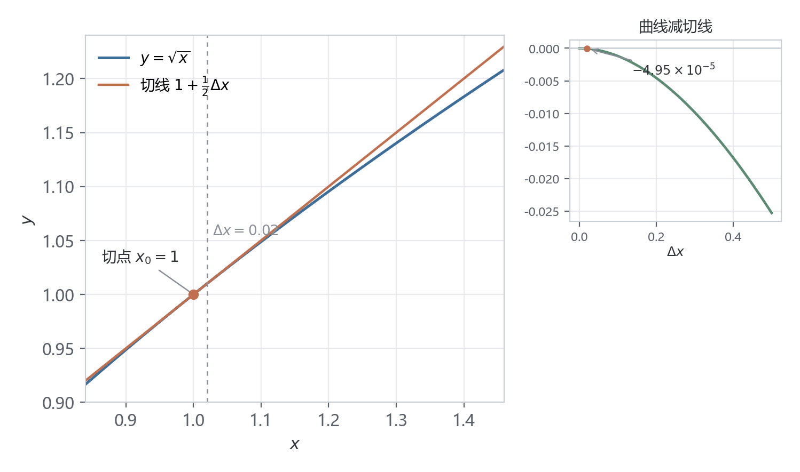
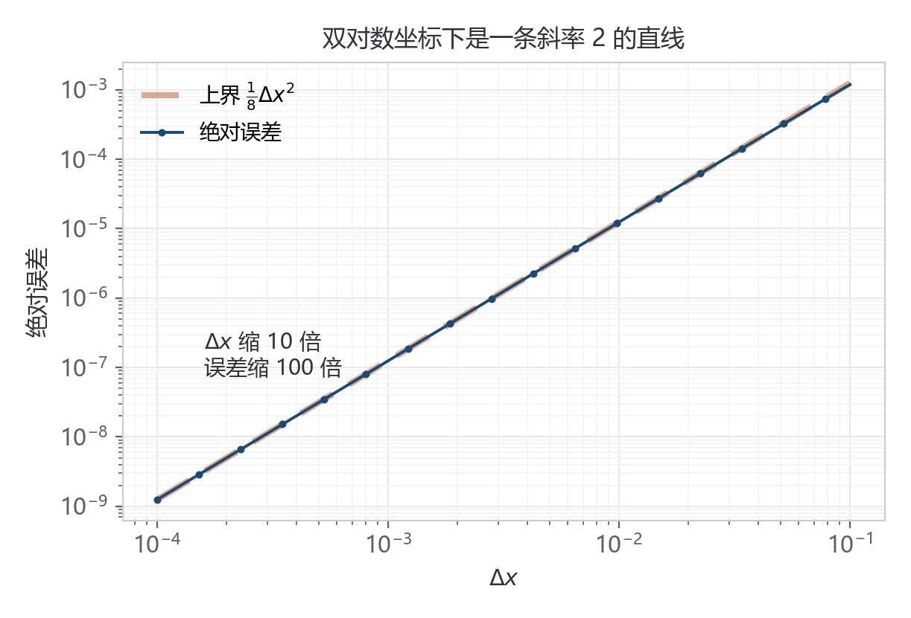

晚自习漂亮学妹们问了关于近似计算的问题，PIEMM 发现自己上次认真看这玩意好像还是一年前啊，竟然被问倒了，作为一个要面子的人，PIEMM 自然要找回场子，这次就仔细写一写这个问题。

近似计算就做一件事：拿只含加减乘除的多项式顶替 $f(x)$，再交代清楚自己这个顶替者和真人差了多少。比如「求 $\sqrt{1.02}$ 的近似值，误差不超过 $10^{-3}$」，考的其实就是三件事——基点取在哪、展到几阶、误差怎么估。

## 近似的由来

学过导数都知道

如果 \(f\) 在 \(x_0\) 处可导，有：
\[
\boxed{
f'(x_0)=\lim_{\Delta x\to 0}
\frac{f(x_0+\Delta x)-f(x_0)}{\Delta x}
}
\]

因此，当 \(\Delta x\) 足够小时，可以写成，注意这里是**足够小**，不是趋近于0：
\[
\frac{f(x_0+\Delta x)-f(x_0)}{\Delta x}
\approx f'(x_0)
\]

然后进一步变形：
\[
\boxed{
f(x_0+\Delta x)-f(x_0)
\approx f'(x_0)\Delta x
}
\]

这其实也就是微分的核心思想。

## 一次近似：切线顶上去

上面那个式子再移个项，也就看到了下面的这个项，这也就是一次近似的由来。

$\Delta x$ 很小时，曲线在一点附近几乎是直的，我们拿切线代替：

$$f(x_0+\Delta x)\approx f(x_0)+f'(x_0)\Delta x$$

$\Delta x$ 就是 $x-x_0$，同一个式子也能写成 $f(x)\approx f(x_0)+f'(x_0)(x-x_0)$，两种都可以，一个更好看基点，一个更容易看偏移量。

来看个经典题目吧，取 $f(x)=\sqrt{x}$、$x_0=1$、$\Delta x=0.02$：

$$\sqrt{1.02}\approx 1+\frac{1}{2}\times 0.02=1.01$$

真值 $1.0099504938$，近似值比真值大 $4.95\times10^{-5}$。小数点后三位以内，够用。（此处当然借助了计算器，PIEMM 当然不会闲的只为了这么个数去算几阶泰勒展开，发现了吗，泰勒展开不也正是近似计算吗）

<figure class="article-figure">

</figure>

误差当然可以更小，来看看泰勒展开吧，运用我们的泰勒公式，只不过这次我们把余项也写了出来，看看一次近似究竟会产生多大的误差：

$$f(x_0+\Delta x)=f(x_0)+f'(x_0)\Delta x+\frac{f''(\xi)}{2}\Delta x^2,\qquad \xi\in(x_0,\,x_0+\Delta x)$$

最后一项跟 $\Delta x^2$ 成正比，所以 $\Delta x$ 小十倍，误差就小一百倍。全文把余项记成近似值减真值，$R_n(x)=P_n(x)-f(x)$，那一项搬过来要变号：

$$R_1(x)=-\frac{f''(\xi)}{2!}(x-x_0)^2$$

<figure class="article-figure">

<figcaption>绝对误差几乎压在上界 Δx²/8 上</figcaption>
</figure>

$\sqrt{x}$ 的二阶导是 $-\frac{1}{4x^{3/2}}$，在 $[1,1.02]$ 上绝对值不超过 $\frac14$，于是

$$|R_1|\le \frac{1}{2}\times\frac{1}{4}\times 0.02^2=5\times10^{-5}$$

实测 $4.95\times10^{-5}$，界几乎贴住实测值。$\xi$ 具体落在哪 PIEMM 不知道，当然也不必知道，反正肯定在 $(x_0,\,x_0+\Delta x)$。

如果再保留一项，也就是保留到二次项，误差还能继续缩小，大概降到 \(4.9\times10^{-7}\)，具体不算了。

## 阶数：多留几项

六个常用展开，骨架是同一个：

$$P_n(x)=\sum_{k=0}^{n}\frac{f^{(k)}(x_0)}{k!}(x-x_0)^k,\qquad R_n(x)=P_n(x)-f(x)$$

| $f(x)$ | 展到三阶 | 收敛范围 |
|---|---|---|
| $e^x$ | $1+x+\dfrac{x^2}{2}+\dfrac{x^3}{6}$ | 全实轴 |
| $\sin x$ | $x-\dfrac{x^3}{6}-R_3(x)$ | 全实轴 |
| $\cos x$ | $1-\dfrac{x^2}{2}-R_3(x)$ | 全实轴 |
| $\ln(1+x)$ | $x-\dfrac{x^2}{2}+\dfrac{x^3}{3}$ | $-1\lt x\le 1$ |
| $(1+x)^{\alpha}$ | $1+\alpha x+\dfrac{\alpha(\alpha-1)}{2}x^2+\dfrac{\alpha(\alpha-1)(\alpha-2)}{6}x^3$ | $\lvert x\rvert\lt 1$ |
| $\dfrac{1}{1-x}$ | $1+x+x^2+x^3$ | $\lvert x\rvert\lt 1$ |

注意哈，这里说的收敛范围，指的是无限泰勒级数的收敛范围，而不是表格中截断后的有限阶多项式。有限多项式本身不存在这样的收敛范围限制。最右边一列最容易被跳过，它决定这个多项式能管多远。前三个全实轴收敛，后三个只在一个半径里有效，这个和级数有关，当然这是很靠后的内容了。

### 余项怎么用

三步：写出拉格朗日余项，找 $n+1$ 阶导在这段上的上界，代进去。

拿 $\ln 1.1$ 的三阶做例子：

$$R_3=-\frac{f^{(4)}(\xi)}{4!}\times 0.1^4,\qquad f^{(4)}(x)=-\frac{6}{(1+x)^4}$$

四阶导是负的，负负得正，$R_3$ 落在 $1.7\times10^{-5}$ 到 $2.5\times10^{-5}$ 之间，跟表格第三行的 $+2.32\times10^{-5}$ 对得上。$x\in[0,0.1]$ 时 $|f^{(4)}|\le 6$，所以 $|R_3|\le\frac{6}{24}\times 10^{-4}=2.5\times10^{-5}$。

各阶实测摆一起：

| 阶数 | 近似值 | 实际误差 |
|---|---|---|
| 1 | $0.1$ | $4.69\times10^{-3}$ |
| 2 | $0.095$ | $-3.10\times10^{-4}$ |
| 3 | $0.0953333$ | $2.32\times10^{-5}$ |

误差的符号来回跳，因为 $\ln(1+x)$ 的展开是**交错级数**。交错级数有更省事的界：误差不超过第一个被丢掉的项。三阶时丢的第一项是 $\frac{0.1^4}{4}=2.5\times10^{-5}$，跟上头用余项算出来的误差上界一模一样。

为什么余项上界和实际误差不相等？

因为交错级数的误差实际上是：
\[
R_3=\frac{0.1^4}{4}
-\frac{0.1^5}{5}
+\frac{0.1^6}{6}-\cdots
\]

后面的项会不断抵消前面的项，所以实际误差小于第一项的绝对值。

两种方法得到的误差上界恰好相同，但实际误差会略小于这个上界。

## 基点：把 x 挪近

展到几阶、误差怎么估，上面都有现成的办法。剩下基点这一件事，它决定这道题能不能算出来。

这里说几个比较实用的思路。第一，能用等价无穷小解决的，就没必要大费周章展开；第二，如果对误差要求比较严格，或者需要保留更高阶的信息，就考虑泰勒展开；第三，尽量选择计算简单、导数容易求的基点。毕竟拿到一个基点，连斜率都算不出来，后面自然没法做。能套公式就套公式，套不了就自己计算，但一定要考虑导数是否存在是否容易求。换句话说，**导数存在，导数便宜**。（更为复杂的东西又涉及级数的收敛半径，收敛范围这些了，这也是为什么选错基点求不出来的原因，这里先不讲，感兴趣直接去看高数下最后一章节，这和前面没啥关系，烧脑又好玩）

### 等价无穷小

$\sin x\sim x$、$\ln(1+x)\sim x$、$e^x-1\sim x$、$\sqrt{1+x}-1\sim\frac{x}{2}$，全是泰勒式取 $x_0=0$ 的结果，区别只在余项被扔掉了。

所以「等价无穷小能不能换」这个问题，实际在问扔掉的项会不会影响结论。乘除里它是高阶，自然掀不起浪；加减里两项相消，被扔掉的项其实是主项，比如：

\[
\lim_{x\to0}\left(\frac1{x^2}-\frac1{\sin^2x}\right)=-\frac13
\]

如果你直接替换，那会爆 0 呢。

## 收尾

近似计算手里就两个旋钮：基点选得合不合适，多项式展到第几阶。基点决定能不能算、阶数决定误差的量级，余项把这个量级算成一个具体的数。

真到动手，先看三样：目标离哪个基点最近，有没有恒等式能折过去，基点那里的导数存不存在，偏不便宜。

忘记说了，关于几何意义，一阶近似有切线，那二阶近似呢？当然是抛物线了。至于曲线到底弯得有多厉害，那就是曲率的事了。
