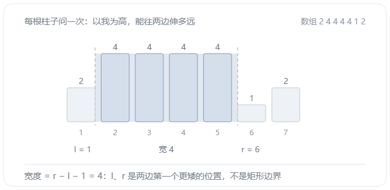
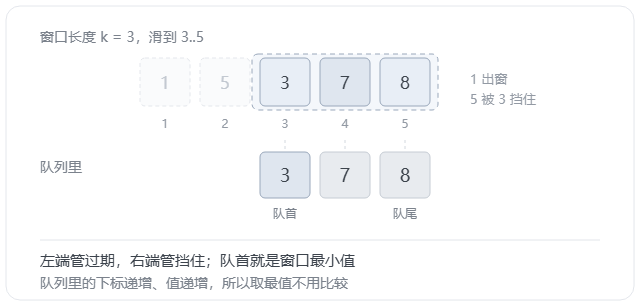

这一节主要还是数据结构的一些操作和技巧，简单的东西一看而过，主要来看看最近复习的单调栈和单调队列。

看到这两个名字，也能知道是做什么的，维持**单调**。

先来看看栈和双端队列的基础语法。

## 两个结构，一张表

| 动作 | `stack` | `deque` |
|---|---|---|
| 增 | `push(x)` | `push_back(x)` |
| 删 | `pop()` | `pop_front()` / `pop_back()` |
| 查 | `top()` | `front()` / `back()` |
| 空 | `empty()` | `empty()` |

`stack` 那列只有一组进出，`deque` 那列有两组，差别就这么多。单调栈和单调队列都不是新结构，只是在这个口上加了一条判断：该弹的弹掉，剩下的自然单调。

栈只有一个口，只有不如新的才会被弹掉，被它压住的元素再也出不来。队列有两个口，多出来的那个专门弹已经出窗的，也就是过期的。所以栈里的元素只有一种死法，队列里有两种。

两个结构都是每个元素进出各一次，总操作 O(n)。

来看看具体操作吧。

## 单调栈

栈能管的问题，答案落在某一侧之内，不用判过期。所以正事只有一件：找边界。边界拿到手之后还能怎么用，是延伸那节的事。

### 找边界

「边界」是个笼统说法，具体就是「左边或右边第一个比我高 / 比我矮的位置」。问一次就是答案，问两次就能算出宽度。

模板题 P5788，从右往左扫，栈里全是「右边还可能有答案的位置」：

```cpp
#include <iostream>
#include <stack>
using namespace std;

const int N = 3e6 + 10;
int a[N], ans[N];

int main() {
    ios::sync_with_stdio(false);
    cin.tie(nullptr);
    int n;
    cin >> n;
    for (int i = 1; i <= n; i++) cin >> a[i];
    stack<int> st;
    for (int i = n; i >= 1; i--) {
        while (!st.empty() && a[st.top()] <= a[i]) st.pop();
        ans[i] = st.empty() ? 0 : st.top();
        st.push(i);
    }
    for (int i = 1; i <= n; i++) cout << ans[i] << ' ';
    cout << '\n';
    return 0;
}
```

**弹完之后栈顶就是第一个更大的；弹空了就是右边没有比自己高的。从右往左，是因为答案在右边，右边先算完才知道谁能留下。**

样例 `1 4 2 3 5` 出 `2 5 4 5 0`。

按动作拆开走一遍。每一步是一个动作，`i` 指到哪格，栈里就留着哪几个候选：



栈里的值从栈底到栈顶一路递减，这就是「单调」的全部内容；每个位置在自己被扫到的那一步就能定下答案，效率很高。

### 延伸：最大子区间

边界本身很多时候不是答案，比如有时需要配上一个宽度。最典型的是直方图最大矩形：每根柱子以自己的高度往两边扩，扩到第一个更矮的为止，扩出来的那段就是它能贡献的最大子区间。

所以每根柱子要问两个方向：左边第一个比我矮的、右边第一个比我矮的。问一次是单调栈，问两次就是两遍，改的只有循环方向。



```cpp
#include <iostream>
#include <stack>
#include <algorithm>
using namespace std;
typedef long long ll;

const int N = 1e5 + 10;
int a[N], l[N], r[N];

int main() {
    int n;
    cin >> n;
    for (int i = 1; i <= n; i++) cin >> a[i];
    stack<int> st;
    for (int i = 1; i <= n; i++) {
        while (!st.empty() && a[st.top()] >= a[i]) st.pop();
        l[i] = st.empty() ? 0 : st.top();
        st.push(i);
    }
    while (!st.empty()) st.pop();
    for (int i = n; i >= 1; i--) {
        while (!st.empty() && a[st.top()] >= a[i]) st.pop();
        r[i] = st.empty() ? n + 1 : st.top();
        st.push(i);
    }
    ll ans = 0;
    for (int i = 1; i <= n; i++) {
        ans = max(ans, (ll)a[i] * (r[i] - l[i] - 1));
    }
    cout << ans << '\n';
    return 0;
}
```

`while (!st.empty()) st.pop();` 清栈：两遍扫的方向相反，第二遍得从空栈开始。只换三处——循环倒过来，`l` 换 `r`，`0` 换 `n + 1`。0 和 n + 1 是两个不存在的哨兵。

剩下宽度的计算就很容易了，本质就是找两个边界。

## 单调队列

队列管的是两侧，而且这段范围会动，所以多了「过期」这一步。按窗口长度是不是给定的，分成两类。定长这一类有三种套法：原数组、前缀和、二维格子。

### 定长滑动窗口

窗口滑起来，左边漏出去，右边挤进来，两头都要弹。模板题 P1886。



```cpp
#include <iostream>
#include <deque>
using namespace std;

const int N = 1e6 + 10;
int a[N];

int main() {
    ios::sync_with_stdio(false);
    cin.tie(nullptr);
    int n, k;
    cin >> n >> k;
    for (int i = 1; i <= n; i++) cin >> a[i];
    deque<int> q;
    for (int i = 1; i <= n; i++) {
        if (!q.empty() && q.front() <= i - k) q.pop_front();
        while (!q.empty() && a[q.back()] >= a[i]) q.pop_back();
        q.push_back(i);
        if (i >= k) cout << a[q.front()] << ' ';
    }
    cout << '\n';
    q.clear();
    for (int i = 1; i <= n; i++) {
        if (!q.empty() && q.front() <= i - k) q.pop_front();
        while (!q.empty() && a[q.back()] <= a[i]) q.pop_back();
        q.push_back(i);
        if (i >= k) cout << a[q.front()] << ' ';
    }
    cout << '\n';
    return 0;
}
```

每一遍都是四步固定顺序：弹过期、弹队尾、进队、取答案。两遍只差中间那个符号，一遍求最小、一遍求最大，P1886 要的就是这两行。下面拿 `1 3 -1 -3 5 3 6 7`、`k = 3` 走一遍，底部带一道蓝线的三格就是当前窗口：



两个方向要分开：**下标**永远递增，按下标顺序进队，先来的在队首；**值**的升降跟题目走，求最小就递增、求最大就递减。

先弹队尾、再进队、最后弹过期，结果是一样的——本质就是弹队首只动队首，弹队尾只动队尾。这里其实就延申出一些问题了，好东西当然要留到最后看了。

注意和单调栈一样，都是**存下标不存值**，这很好理解吧，值可没办法判断是否自己在窗口期，但存下标既可以获得值，也能判断位置。

### 延伸：长度限制最大子段和

「长度不超过 m 的最大子段和」（P1714 切蛋糕），窗口里装的不是数，是一段和。

转一次：子段和等于两个前缀和相减，`s[j] - s[i]`，长度限制变成 `j - i <= m`。对每个 `j`，要的是 `[j - m, j - 1]` 里最小的前缀和，拿 `s[j]` 减掉它。于是变成「滑动窗口求最小值」。

```cpp
#include <iostream>
#include <deque>
#include <algorithm>
using namespace std;
typedef long long ll;

const int N = 5e5 + 10;
ll s[N];

int main() {
    ios::sync_with_stdio(false);
    cin.tie(nullptr);
    int n, m;
    cin >> n >> m;
    for (int i = 1; i <= n; i++) {
        ll x;
        cin >> x;
        s[i] = s[i - 1] + x;
    }
    deque<int> q;
    q.push_back(0);
    ll ans = -1e18;
    for (int i = 1; i <= n; i++) {
        while (!q.empty() && q.front() < i - m) q.pop_front();
        ans = max(ans, s[i] - s[q.front()]);
        while (!q.empty() && s[q.back()] >= s[i]) q.pop_back();
        q.push_back(i);
    }
    cout << ans << '\n';
    return 0;
}
```

这就是我前面所表示过的队头和队尾的操作是独立的，队头索引来负责窗口，队尾值来负责条件。

### 延伸：二维就是扫两遍

P2216 理想的正方形：给一个 n×m 的矩阵，找一个 k×k 的方块，让块里最大值减最小值最小。题面把行数、列数、方块边长记作 a、b、n，这里换成 n、m、k。

一维会了，二维只是把它套两层。先在每行上横着滑一遍，把每个位置往左 k 个数的最大最小存进 `rowMax`、`rowMin`；再对这两张表竖着滑一遍，就得到每个 k×k 方块的最大最小。

下面这 27 步走的就是这两个过程，先横向把表填满，再纵向把方块读出来：



代码只是把这两件事写成两层循环：

```cpp
#include <iostream>
#include <deque>
#include <algorithm>
using namespace std;

const int N = 1010;
int a[N][N], rowMax[N][N], rowMin[N][N];

int main() {
    int n, m, k;
    cin >> n >> m >> k;
    for (int i = 1; i <= n; i++) {
        for (int j = 1; j <= m; j++) cin >> a[i][j];
    }
    for (int i = 1; i <= n; i++) {
        deque<int> mx, mn;
        for (int j = 1; j <= m; j++) {
            if (!mx.empty() && mx.front() <= j - k) mx.pop_front();
            while (!mx.empty() && a[i][mx.back()] <= a[i][j]) mx.pop_back();
            mx.push_back(j);
            if (!mn.empty() && mn.front() <= j - k) mn.pop_front();
            while (!mn.empty() && a[i][mn.back()] >= a[i][j]) mn.pop_back();
            mn.push_back(j);
            if (j >= k) {
                rowMax[i][j] = a[i][mx.front()];
                rowMin[i][j] = a[i][mn.front()];
            }
        }
    }
    int ans = 1e9;
    for (int j = k; j <= m; j++) {
        deque<int> mx, mn;
        for (int i = 1; i <= n; i++) {
            if (!mx.empty() && mx.front() <= i - k) mx.pop_front();
            while (!mx.empty() && rowMax[mx.back()][j] <= rowMax[i][j])
                mx.pop_back();
            mx.push_back(i);
            if (!mn.empty() && mn.front() <= i - k) mn.pop_front();
            while (!mn.empty() && rowMin[mn.back()][j] >= rowMin[i][j])
                mn.pop_back();
            mn.push_back(i);
            if (i >= k) {
                int hi = rowMax[mx.front()][j];
                int lo = rowMin[mn.front()][j];
                ans = min(ans, hi - lo);
            }
        }
    }
    cout << ans << '\n';
    return 0;
}
```

`rowMax[i][j]` 只在 `j >= k` 时有意义，前面几列是空的，所以竖着这遍的外层循环从 `k` 开始。

横着那遍每行 O(m)，n 行是 O(nm)；竖着那遍每列 O(n)，m 列也是 O(nm)。总 O(nm)。

### 不定长滑动窗口

右端点一直往右滑，这点没变。变的只有左端点怎么定：定长看时间，到点就过期；不定长看新元素，条件破了才挪。

P3512：给一个序列和 k，求最长的一段，段内最大值减最小值不超过 k。两条队列，一条管最大一条管最小，队首相减就是当前极差：

```cpp
#include <iostream>
#include <deque>
#include <algorithm>
using namespace std;

const int N = 3e6 + 10;
int a[N];

int main() {
    ios::sync_with_stdio(false);
    cin.tie(nullptr);
    int k, n;
    cin >> k >> n;
    for (int i = 1; i <= n; i++) cin >> a[i];
    deque<int> mx, mn;
    int L = 1, ans = 0;
    for (int i = 1; i <= n; i++) {
        while (!mx.empty() && a[mx.back()] <= a[i]) mx.pop_back();
        mx.push_back(i);
        while (!mn.empty() && a[mn.back()] >= a[i]) mn.pop_back();
        mn.push_back(i);
        while (a[mx.front()] - a[mn.front()] > k) {
            if (mx.front() < mn.front()) {
                L = mx.front() + 1;
                mx.pop_front();
            } else {
                L = mn.front() + 1;
                mn.pop_front();
            }
        }
        ans = max(ans, i - L + 1);
    }
    cout << ans << '\n';
    return 0;
}
```

那个 `if` 是唯一要动脑的地方。极差只由这两个极值决定，所以要放走一个；两者里更靠左的那个一定先出窗，`L` 就跟着它跳到右边一位，再看还超不超。

`L` 的更新不是判断时间，而是判断新元素。每个元素进出各一次，`L` 只往右不回头，O(n)。

## 注意细节

- **判断条件**：值的比较需不需要带 `=`。
- **存的是什么**：下标。值只用来比，位置用来判过期和算宽度。
- **先弹还是先取**：看是由"时间决定"（定长）还是"新元素决定"(不定长)。

## 收尾

总结的东西其实这篇的标题和描述已经给出了，下面聊一聊单调队列的另一个话题，
首先就是如果单调队列这个东西去掉一边它是什么呢，去掉首端你会发现它做的就是栈做的事，单调栈能做的它也能做，
去掉尾端你会发现做的也正好就是普通队列做的事情，队列最大的好处就是处理顺序，而栈则是处理当前正在发生的。
线性数据结构比较简单，就写到这，后续DP优化再写更多他们的操作吧。