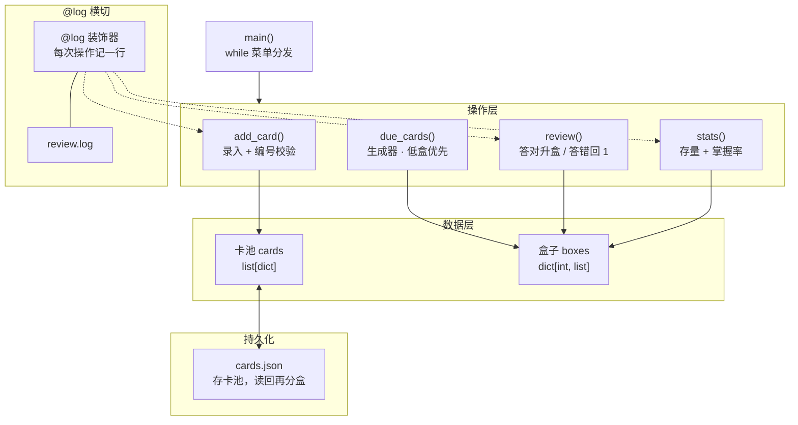

<!--more-->

<!--
写作提示（草稿专用，发布前删掉本注释块）：
- 定位：八篇收官项目，把八篇尽量全用上；每处用法必须自然，宁缺勿硬塞
- 八篇覆盖清单（写作时逐项打勾）：
  [基础]   input / while 菜单 / if-elif / f-string
  [容器]   列表(卡池) 字典(每张卡) 字典套列表(五个盒子) 集合(标签去重) 元组(统计返回值) 切片(最近录入)
  [函数]   拆函数 / lambda+sorted(key=) 按盒号排序 / any-all(某标签是否全进高盒)
  [字符串] strip/split 处理输入 / startswith 过滤标签 / f-string 对齐打印
  [正则]   re.match 校验卡片编号格式（如 K001），不对拒收
  [类]     CardBox / __repr__ 打印一张卡 / @property 掌握率（还装饰器篇的账）
  [文件]   json 存档读档 / FileNotFoundError 是唯一必讲异常
  [装饰器] 操作日志装饰器 @log（functools.wraps 一句带过）
  [生成器] due_cards() 逐个 yield 该复习的卡（低盒优先）
- 新语法只有 random（抽卡）和 json（存档）两个，各一句带过
- 代码块全部待填、待实测；print 的输出注释必须和真实运行一致
- 文末收尾把「下一篇」指向数据篇（numpy），呼应规划篇
-->

## 开场

八篇写完，语法这一趟算走完了。但看懂和会写是两回事——每一篇的东西单独拎出来都懂，拼在一起才是另一回事。

手边要背的东西不少：考研英语的单词、CACC 的算法套路、CMC 的结论。它们的形态其实一样，一张卡正面一句、背面一句，翻过来对一下就知道会不会。

与其为每种东西各写一个工具，不如做一个卡片盒。这篇把它写出来，八篇里讲过的东西每一样都会在里面占一个位置——不是因为要用满，是因为它们本来就是干这个的。

## 先想清楚要什么

功能先砍到五件：

- 录一张卡，编号、正面、背面、标签
- 复习：抽一张出来，先看正面，自己回想，回车看背面
- 答对往下走，答错退回起点
- 看各盒存量，算一个掌握率
- 存档，关掉程序卡还在

先追求跑起来。按标签专项复习、隔几天再提醒、导出报表这些，都留到收尾再说。

## 全景：分四层

整个程序就四层——入口是菜单，操作是几个函数，数据是卡池和五个盒子，最下面是两个文件。



卡池和盒子是同一批卡片的两套索引：卡池按录入顺序放，盒子按熟不熟分装。存盘只存卡池，盒子里的盒号是卡片自己的一个字段，读回来重新分一次就还原了。

## 一张卡片长什么样

一张卡就是一个字典，五个键：编号、正面、背面、标签、盒号。卡池是这些字典组成的列表。

```python
{
    "id": "K001",
    "front": "quick",
    "back": "快的；迅速的",
    "tags": ["英语"],
    "box": 1,
}
```

存成 JSON 之后长这样，读回来还是字典，不用转换。

## 五个盒子：先讲规则

Leitner 的规则只有两条：答对升一盒，答错回 1 号盒。五个盒子就是五个列表，装在不同格子里。

```python
# 待填：boxes = {1: [], 2: [], 3: [], 4: [], 5: []}
```

越靠后的盒子越熟。复习时从 1 号盒开始往后找，找到有卡的就开始抽——这样最生的卡总是先被翻出来，熟了自然沉到后面去。这是最省事的艾宾浩斯，不用记时间，只看对错。

## 录卡：先验格式再入库

编号统一成 `K001` 这种形状，三位数字。录入时用正则验一遍，形状不对就退回去重输，别让脏数据进库。

```python
# 待填：re.match(r"^K\d{3}$", card_id) 校验
```

正面背面一律 `strip()` 掉两头空白。标签允许多个，用逗号隔开，`split(',')` 切开之后存成列表——这里顺带用集合去一次重，防止同一个标签写两遍。

## 复习：抽一张，答对升盒

复习的入口是一个生成器：从 1 号盒开始，逐个把该复习的卡递出来。抽卡的时候不用先把所有卡拼成一个大列表，`for` 走到哪算哪。

```python
# 待填：def due_cards(boxes): 逐个 yield
```

拿到一张卡，先印正面让人回想，回车再印背面，然后自己判对错。答对盒号加一（到了 5 就停在那），答错直接回 1。改完盒号这张卡就换了盒子，记得存盘。

## 掌握率和各盒存量

各盒存量就是每盒 `len()` 一下，一行一行打出来，用 f-string 对齐。掌握率算 4、5 号盒占全部卡的比例——越熟越靠后，靠后的占比就是熟了多少。

```python
# 待填：stats() 返回 (熟卡数, 总数)，调用处解包
```

想再加一点：`any()` 和 `all()` 判断某个标签是不是全进了高盒。一个标签的卡全熟了，这个标签就可以先放下。

## 存档：关掉程序卡还在

卡池整个写进 `cards.json`，下次打开读回来。第一次运行文件还不存在，`open()` 会抛 `FileNotFoundError`——这是全项目唯一一处必须写 `try` 的地方，因为它是真的会发生，不是防着玩。

```python
# 待填：json.dump / json.load + try except FileNotFoundError
```

## 把散的装进类

前面这些函数都是散着的，每个都要把卡池或盒子当参数传一遍。装进一个 `CardBox` 里，`__init__` 负责读档分盒，其余函数变成方法，`self` 一挂就不用再传参数了。

```python
# 待填：class CardBox: __init__ / add / due / review / stats / save
```

两个魔法方法顺手用上：`__repr__` 让 `print` 一张卡直接是可读的几行，而不是一串地址；掌握率做成 `@property`，用的时候像一个属性，`book.rate`，不用加括号。

## 给关键操作记一笔日志

录卡、复习、存档这三件事，每做一次往 `review.log` 追加一行带时间的记录。写成一个装饰器套在方法上，比在每个函数里各抄一遍 `open()` 干净。

```python
# 待填：def log(func): 包一层，写日志，functools.wraps(func)
```

`functools.wraps` 别忘——不写的话日志里、报错栈里看到的全是 `wrapper`，之前那篇讲过这个坑。

## 跑起来

拼起来就是一个 `while True` 的菜单：输入数字选功能，`if/elif` 分发，输错了给个提示接着循环，别让程序崩。

```python
# 待填：完整可运行版（全文唯一的长代码块）
```

跑起来之后，输出里能同时看到两样东西：f-string 对齐的盒存量表格，和 `__repr__` 打出来的一张卡。

## 收尾

能扩的地方不少，各一句：按标签专项复习（输入 `英语` 只抽英语卡，`startswith` 就能做前缀匹配）；隔几天再提醒（给卡记一个上次复习的日期，比对当前日期）；导出成一张表（`csv` 模块）。这些都不动核心，加一个菜单项就行。

卡片攒到几百张，自己算「哪个标签最差」就累了——那是下一阶段的事。数据篇从 numpy 开始，pandas 处理这种表格一行就够。
