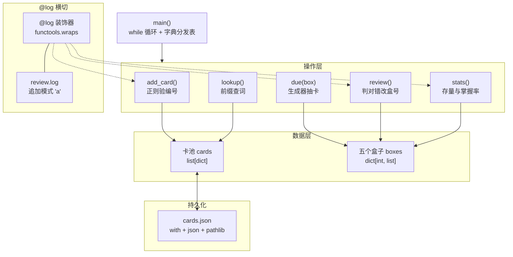

<!--more-->

<!--
写作提示（草稿专用，发布前删掉本注释块）：
- 定位：八篇收官项目，把八篇尽量全用上；每处用法必须自然，宁缺勿硬塞
- 主用途：背英语单词（考研）。三种题型：英译汉（自评）/ 汉译英（精确判）/ 句子填空（精确判，卡带 cn 译文、答案只留一个形式）+ 词组
- 五个功能：录入 / 复习（可选盒，每张印盒号）/ 清单（按盒排序）/ 统计 / 查阅（front 前缀匹配，释义 + 盒号）/ 存档
- 关键取舍：英译汉不自动判——完全匹配意思太难；抽出来看正面、回想、翻面、自己判对错
- 八篇覆盖清单（写作时逐项打勾）：
  [入门]   虚拟环境/命名习惯（一句带过）
  [基础]   input / while 菜单 / if-elif / f-string 对齐
  [容器]   列表(卡池) 字典(每张卡) 字典套列表(五盒) 集合(标签去重+差集) 元组(统计返回值) 切片(最近录入) 推导式(筛选)
  [函数]   四种参数(默认参数) / 多返回值 / 函数是对象(菜单字典分发表) / 模块 import(拆两个文件) / lambda+sorted / any-all
  [字符串] strip/split/lower/startswith / f-string / 方法表
  [正则]   编号校验 + 句子填空的占位切分 + 多答案按竖线切
  [类]     Card 基类 + 子类覆盖 check()（继承的一点）/ __repr__ / @property
  [文件]   with / 读 / 写 / 追加模式 'a' / pathlib / json / FileNotFoundError
  [装饰器] @log + functools.wraps
  [生成器] due_cards() 逐个 yield（低盒优先）
- 代码块全部待填、待实测；print 的输出注释与终端示意必须和真实运行一致
- 文末收尾把「下一篇」指向数据篇（numpy），呼应规划篇
-->

## 开场

八篇写完，语法这一趟算走完了。但看懂和会写是两回事——每一篇的东西单独拎出来都懂，拼在一起才是另一回事。

这篇不虚构需求。手边真正要背的是考研英语：单词、词组、还有句子里的搭配。形态无非三种——给英文想中文、给中文写英文、给个空填进去。

三种都能塞进同一个盒子。这篇把它写出来，八篇里讲过的东西每一样都会在里面占一个真实位置。

## 先看它能干什么

跑起来就是一段终端对话，没有界面：

```text
$ python main.py
1 录入  2 复习  3 清单  4 统计  5 查阅  0 退出
> 2
复习哪个盒？1-5，回车=全部 > 1

[1 号盒] K012
正面：abandon
回车看背面 > 
背面：放弃；抛弃
对了吗？y/n > y
升到 2 号盒

[1 号盒] K018
正面：坚持
输入英文 > persist
对。
升到 2 号盒

[1 号盒] K025
正面：He ___ to finish the report by Friday.
译文：他在周五之前完成了那份报告。
输入英文 > manage
错。答案 managed。
退回 1 号盒
```

三张卡，三种判法：第一张是你自己判，第二、三张程序判。每张卡前头都标着它现在在几号盒，复习前也能先选只抽哪一盒——1 号盒全是生词，考前只想扫一遍 4、5 号盒也只要按一个数字。

查词是另一个入口，直接给释义和盒号：

```text
> 5
查词 > aban
K012  abandon  放弃；抛弃  [2 号盒]  unit3
```

不用翻清单找，输入前几个字母就够。这就是整个项目的效果——不用开网页、不用连网，一个 `python main.py` 就能背。

## 先想清楚要什么

功能砍到七件：

- 录一张卡：编号、正面、背面、标签，还要标题型（填空卡多一句译文）
- 复习：先选盒（1 到 5，或全部），抽到的每张都印出它属于哪一盒
- 答对升一盒，答错回 1 号盒
- 清单：按盒号排一遍，看每张卡在哪一盒
- 统计：各盒存量、掌握率、最近录了哪些、按标签还差哪几张
- 查阅：输入单词或中文，查释义和盒号
- 存档，关掉程序卡还在

题型四种，只有判断题要不要自动判：

| 题型 | 正面 | 背面 | 怎么判 |
|---|---|---|---|
| 英译汉 | `abandon` | `放弃；抛弃` | 自评（翻面后自己点 y/n） |
| 汉译英 | `坚持` | `persist` | 自动：输入比对 |
| 句子填空 | `He ___ ... Friday.` | `managed` + 译文 | 自动：输入填进空里 |
| 词组 | `look forward to` | `期待；盼望` | 自评 |

英译汉不自动判——中文答案说法太多，「放弃」和「抛弃」都对，机器判不了。抽出来自己看自己判，和翻单词书一样。

程序里只写三个类：英译汉和词组都是「正面英文、背面中文、自己判」，走同一条路，省一套代码；汉译英和填空各一个，能自动判。

填空卡除了句子还得有一句译文。光看 `He ___ to finish the report by Friday.` 猜不出该填原形还是过去式，译文把意思定下来，这一步才判得了。

## 全景：四层加一个横切

整个程序分四层，最上面是菜单，中间是操作，下面是数据和两个文件；`@log` 横着盖在三个关键操作上，每次操作往日志里记一行。



卡池和盒子是同一批卡片的两套索引：卡池按录入顺序放，盒子按熟不熟分装。存盘只存卡池，盒号是卡片自己的一个字段，读回来重新分一次盒就还原了。

每个节点用的都是前面某一篇的东西，对应关系在这：

| 位置 | 来自哪篇 | 具体用法 |
|---|---|---|
| `main()` 菜单 | 基础篇 + 函数篇 | `while True` + `if/elif`；分发用字典 `{'1': add_card, ...}`，因为函数是对象 |
| 编号校验 | 字符串 + 正则 | `strip()` 去空白，`re.match(r"^[A-Z]+\d{3}$", ...)` 验形状 |
| 标签处理 | 容器：列表/集合 | `split(',')` 切开，`set()` 去重，`-,&` 求差集看哪张还没掌握 |
| 抽卡 | 装饰器篇：生成器 | `due(box=None)` 逐个 `yield`；给了盒号就只走那一盒，`None` 时从 1 号盒走到 5 号 |
| 判定 | 字符串方法 | `NFKC` 折半角 + `strip()` + `lower()` 后比对；答案用竖线分隔，任一命中算对 |
| 填空切分 | 正则 | `re.split(r"_{2,}", sentence)` 把句子和空位分开 |
| 统计 | 容器 + 函数 | 字典累加，返回元组 `(熟卡数, 总数)` 由调用处解包；`any/all` 判标签是否全掌握 |
| 排序和筛选 | 容器推导式 + 函数 | `[c for c in cards if ...]`、`sorted(key=lambda c: c["box"])`、切片 `cards[-5:]` |
| 查词 | 字符串 + 推导式 | 输入转小写后比 `startswith`，命中几张就全列出来（一个前缀查一片） |
| 卡片类 | 类篇 | `Card` 基类 + `WordCard`/`ClozeCard` 子类覆盖 `check()`；`__repr__` 打印一张卡 |
| 掌握率 | 装饰器篇（@property） | 写成属性，`book.rate` 不加括号 |
| 存档 | 文件篇 | `with open(...)` + `json`；`FileNotFoundError` 是唯一必写的 `try` |
| 日志 | 装饰器篇 + 文件篇 | `@log` 包一层，`open(path, 'a')` 追加，`pathlib.Path` 拼路径 |
| 拆文件 | 函数篇：模块 | `cards.py` 放类，`main.py` 里 `from cards import CardBox` |

## 一张卡片长什么样

一张卡在内存里是个小对象，落到磁盘上就是一个字典。四种题型共用一套键，靠 `type` 区分，`back` 一栏兼作答案。

```python
{"id": "K012", "type": "en2cn", "front": "abandon",
 "back": "放弃；抛弃", "tags": ["unit3"], "box": 1}

{"id": "K018", "type": "cn2en", "front": "坚持",
 "back": "persist|persevere", "tags": ["unit3"], "box": 2}

{"id": "K025", "type": "cloze", "front": "He ___ to finish the report by Friday.",
 "back": "managed", "cn": "他在周五之前完成了那份报告。", "tags": ["unit5"], "box": 1}
```

`back` 里用竖线隔开多个可接受答案，判的时候拆开比。不用 `/`——答案本身带斜杠的不少（`and/or`、`24/7`），一拆就散。填空卡的 `front` 里用两个以上下划线表示空位——位置由正则找，不靠人记。

`cn` 只有填空卡有，存那句译文，印正面时一并印出来。这类卡的 `back` 一般只留一个答案：时态、单复数往往正是这个空要考的东西，把 `manage/managed/manages` 全列上，写错形式也会被判对。

读回来按 `type` 造回对应的类，盒号从 `box` 字段重新分一次就有了——盒子本身不单独存盘。

## 五个盒子：先讲规则

Leitner 的规则只有两条：答对升一盒，答错回 1 号盒。五个盒子就是五个列表，装在不同格子里。

```python
boxes = {i: [] for i in range(1, 6)}

for c in cards:
    boxes[c.box].append(c)
```

越靠后的盒子越熟。复习时从 1 号盒开始往后找，找到有卡的就开始抽——最生的卡总是先被翻出来，熟了自然沉到后面。这是最省事的艾宾浩斯，不用记时间，只看对错。

## 录卡：先验格式再入库

编号统一成 `K001` 这种形状，字母加三位数字。录入时用正则验一遍，形状不对就退回去重输，别让脏数据进库。

```python
def add(book, cid):
    if not re.match(r"^[A-Z]+\d{3}$", cid):
        print("编号形状不对，要字母加三位数字")
        return
    if any(c.id == cid for c in book.cards):
        print("这个编号已经有了")
        return
```

正面、背面、标签一律 `strip()` 掉两头空白。标签允许多个，逗号隔开，`split(',')` 切开以后存成列表，顺手用集合去一次重——同一个标签写两遍也只留一个。

编号重复也要拦：`any(c.id == cid for c in book.cards)` 查一遍，已经有了就不让录。

## 三种判定：自评、精确、填空

判定分两路。英译汉和词组走自评：程序只负责翻面，对了错了由你按键。

```python
class Card:
    def check(self, typed):
        return None          # None 就是「这种卡自己判」


class AskCard(Card):
    def check(self, typed):
        return norm(typed) in self.answers()
```

汉译英和填空走自动判：输入先规范化，再拿 `back` 按竖线拆出来的候选逐个比，命中任意一个就算对。

```python
def answers(self):
    return [norm(a) for a in self.back.split("|")]
```

规范化不只是 `lower()`。中文输入法打出来的英文是全角（`ｐｅｒｓｉｓｔ`），得先用 `unicodedata.normalize('NFKC', s)` 折回半角，再 `strip()`、再 `lower()`。

填空多一步：用 `re.split(r"_{2,}", front)` 把句子切成前后两段，接着印 `cn` 那句译文，再等输入。判断用精确比较——空的答案就一个词，没有「意思相近」的余地。

## 复习：抽一张，答对升盒

复习前先问一句抽哪个盒：输入 1–5 只走那一盒，直接回车就五盒全过一遍。

```python
def due(self, box=None):
    for b in ([box] if box else range(1, 6)):
        for c in self.boxes[b]:
            yield c
```

抽卡不用先把所有卡拼成一个大列表，`for` 走到哪算哪，最生的先出来。

拿到一张卡，第一行印 `[3 号盒] K018`——盒号就在卡片的 `box` 字段里，抽出来顺手印上。不印的话一页卡滚过去，分不清哪张是刚录的生词、哪张已经到 4 号盒了。

然后印正面（填空卡连译文一起印）。自动判的题型直接等输入，自评的题型等一个回车翻面、再等一个 y/n。判定完改盒号：答对加一（到 5 就停），答错回 1。改完这张卡就换了盒子，记得存盘。

两处边界得管：卡池空的时候直接说一句「还没有卡」，别进去抽；盒号输了 6 或者字母，当作「全部」重问一遍。中途 `Ctrl+C` 退出也要存盘，不然这一轮白复习。

## 统计和清单

各盒存量就是每盒 `len()` 一下，一行一行打出来，用 f-string 对齐。掌握率算 4、5 号盒占全部卡的比例——越熟越靠后，靠后的占比就是熟了多少。一张卡都没有时按 0 算，别让 `0/0` 抛 `ZeroDivisionError`。

```python
def stats(self):
    return sum(1 for c in self.cards if c.box >= 4), len(self.cards)


done, total = book.stats()
```

想看某张卡在第几号盒，用菜单的「清单」：把卡池按 `c["box"]` 排一遍，每行印盒号、编号、正面——盒号取的是卡片里的 `box` 字段，不是它在第几个列表里的下标：

```text
 盒  编号   正面
  1  K012   abandon
  1  K025   He ___ to finish the report by Friday.
  2  K018   坚持
  5  K003   look forward to
```

再补两个小功能：按标签筛「还差哪几张」（集合差集，全部减已掌握）；看最近录的五张（切片 `cards[-5:]`）。

## 查词：打前几个字母就够

查词不做精确匹配，输入 `aban` 也要能查到 `abandon`。两边都转小写，用 `startswith` 比前缀，命中几张全列出来：

```python
hits = [c for c in book.cards if norm(c.front).startswith(norm(q))]
```

一行一张：编号、正面、背面、盒号、标签。中文也能查——汉译英卡的 `front` 是中文，输「坚持」一样命中。查不到就回一句「没有」，不要静默返回空；输入是空的直接回菜单，否则空串会匹配到全部。

前缀匹配顺带解决拼不准的问题：记不清后半截，打前几个字母就行。

## 存档：关掉程序卡还在

卡池整个写进 `cards.json`，下次打开读回来。第一次运行文件还不存在，`open()` 会抛 `FileNotFoundError`——这是全项目唯一一处必须写 `try` 的地方，因为它是真的会发生，不是防着玩。

```python
def save(self):
    with open(self.path, "w", encoding="utf-8") as f:
        json.dump([c.to_dict() for c in self.cards], f, ensure_ascii=False, indent=1)


try:
    with open(path, encoding="utf-8") as f:
        raw = json.load(f)
except FileNotFoundError:
    raw = []
```

路径用 `pathlib.Path` 拼，别写死反斜杠；文件跟程序放一个目录，`Path(__file__).parent / "cards.json"`，从哪个目录启动都能找到。

## 把散的装进类

这些操作要是写成散函数，每个都得把卡池当参数传一遍。所以干脆一开始就装进一个 `CardBox`：`__init__` 负责读档分盒，其余都写成方法，`self` 一挂就不用再传参数。

```python
class CardBox:
    def __init__(self, path=DATA):
        self.path = path
        # 上一节那段读档，raw 是读回来的字典列表
        self.cards = [make_card(d) for d in raw]
        self.boxes = {i: [] for i in range(1, 6)}
        for c in self.cards:
            self.boxes[c.box].append(c)

    @property
    def rate(self):
        if not self.cards:
            return 0.0
        return sum(1 for c in self.cards if c.box >= 4) / len(self.cards)
```

两个魔法方法顺手用上：`__repr__` 让 `print` 一张卡直接是可读的几行，而不是一串地址；掌握率做成 `@property`，用的时候像属性，`book.rate` 不加括号。

题型那一层用一点点继承：`Card` 基类定义 `check()` 返回 `None`（意思是自评），`ClozeCard` 子类覆盖它，改成精确比对。四个题型共用一个方法名，调用处不用问是哪一种。

## 给关键操作记一笔日志

录卡、复习、存档这三件事，每做一次往 `review.log` 追加一行：时间、操作、卡号。

```python
def log(func):
    @functools.wraps(func)
    def wrapper(*args, **kwargs):
        result = func(*args, **kwargs)
        card = args[1] if len(args) > 1 else None
        cid = getattr(card, "id", "")
        stamp = datetime.now().strftime("%m-%d %H:%M")
        with LOG.open("a", encoding="utf-8") as f:
            f.write(f"{stamp}  {func.__name__}  {cid}\n")
        return result
    return wrapper
```

写日志要 `open(path, 'a')` 追加模式——用 `'w'` 会把上一次的日志冲掉。`functools.wraps` 别忘，不写的话日志和报错栈里看到的全是 `wrapper`，之前那篇讲过这个坑。

## 拆成两个文件

代码到这儿有点长了，按职责拆开：`cards.py` 放三个类，`main.py` 只放菜单和交互。

```python
# cards.py：Card / WordCard / AskCard / ClozeCard / CardBox / norm / log
# main.py：from cards import CardBox, WordCard, AskCard, ClozeCard
```

拆开的好处不是好看，是改类的时候不用在一千行里翻菜单代码。这也是模块那一节讲过的：一个 `.py` 文件就是一个模块，`import` 进来就能用。

## 跑起来

拼起来就是一个 `while True` 的菜单：输入数字选功能。分发用字典——`{'1': add_card, '2': review, '3': list_cards, '4': stats, '5': lookup}`，因为函数可以当值放进去，查一下键就能调用，比一长串 `if/elif` 干净。

```python
MENU = {"1": add, "2": review, "3": list_cards, "4": stats, "5": lookup}


def main():
    book = CardBox()
    while True:
        print("\n1 录入  2 复习  3 清单  4 统计  5 查阅  0 退出")
        choice = input("> ").strip()
        if choice == "0":
            book.save()
            break
        func = MENU.get(choice)
        if func is None:
            print("没有这个选项")
            continue
        try:
            func(book)
        except (KeyboardInterrupt, EOFError):
            book.save()
            print("\n中途退出，已存盘")
            break
```

跑起来之后，输出里能同时看到几样东西：f-string 对齐的盒存量表格、`__repr__` 打出来的一张卡、追加进 `review.log` 的记录。

## 收尾

能扩的地方不少，各一句：按标签复习（给 `due` 再加一个标签参数，只抽 unit3 那批）；隔几天再提醒（给卡记一个上次复习的日期，跟今天比）；导出成一张表（`csv` 模块）。

卡片攒到几百张，自己算「哪个标签最差」就累了——那是下一阶段的事。数据篇从 numpy 开始，pandas 处理这种表格一行就够。
