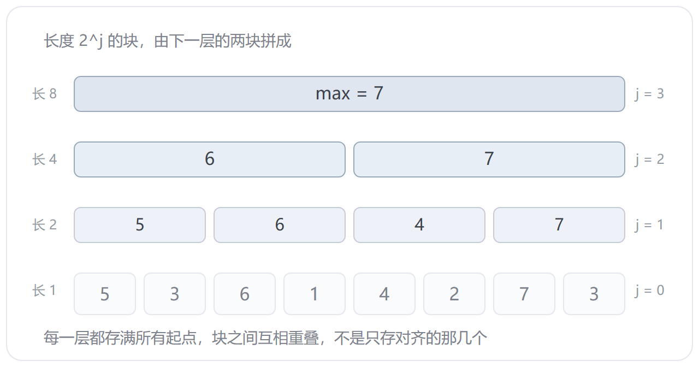

前面几篇都绕着「位置」转：单调队列管窗口一段段走过去，离散化把值换成排名，ST 表把区间压成两块 2 的幂。这一篇把两个最不像的结构摆在一起——ST 表和哈希表。它们的共同点是查一次就出结果，可这两种 `O(1)` 的来源几乎相反。

ST 表只做一件事，**倍增**：长度 1 的区间拼成 2，2 拼成 4，一路翻上去。查询时随便给个区间，两块 2 的幂就能盖住，多出来的那截重叠，取最值不介意。代价是它只认位置，一个数都改不得。

哈希表反过来，它不认位置，只认值：给一个键，算一个桶号，直接跳过去。增删查都是常数，代价是桶里没有顺序，问不了「这段里最大的是谁」。

上半篇 ST 表，下半篇哈希表，最后把这两种 `O(1)` 摆在一起比。

## 两份模板

两份只差两个词：转移那行的 `max`，查询那行的 `max`，换成 `min` 就是最小值版。数组、`lg`、边界、循环顺序，一个字都不用动。

下面这份是最大值版，也就是题一 P3865 的答案：

```cpp
#include <iostream>
#include <algorithm>
using namespace std;

const int N = 1e5 + 10;
const int LOG = 17;

int st[N][LOG];
int lg[N];

int main() {
    ios::sync_with_stdio(false);
    cin.tie(nullptr);
    int n, m;
    cin >> n >> m;
    lg[0] = -1;
    for (int i = 1; i <= n; i++) {
        cin >> st[i][0];
        lg[i] = lg[i >> 1] + 1;
    }
    for (int j = 1; j < LOG; j++) {
        int h = 1 << (j - 1);
        for (int i = 1; i + (1 << j) - 1 <= n; i++) {
            st[i][j] = max(st[i][j - 1], st[i + h][j - 1]);
        }
    }
    for (int i = 1; i <= m; i++) {
        int l, r;
        cin >> l >> r;
        int k = lg[r - l + 1], len = 1 << k;
        cout << max(st[l][k], st[r - len + 1][k]) << '\n';
    }
    return 0;
}
```

`lg` 和读入挤在一个循环里，省一遍扫。`lg[0] = -1` 是给 `lg[1]` 铺路的：`lg[1] = lg[0] + 1 = 0`。这个数组算出来的是 `⌊log2 i⌋`，查询里天天用。

`h` 是下面那层的块长，`len` 是这次查询的块长。两个都是 `2` 的幂，写成变量只为少敲几遍 `1 << k`。

`LOG` 取 17 是因为 `n ≤ 1e5`，`⌊log2 1e5⌋ = 16`，层号 0 到 16 正好 17 层。数组一共 `1e5 × 17` 个 `int`，6.8MB，125MB 的限够用。

## 表是怎么搭的

`st[i][j]` 是从 `i` 开始、长度 `2^j` 的区间最值。`j = 0` 就是 `a[i]` 本身，再往上一层，两个相邻的块拼成一个：

`st[i][j] = max(st[i][j-1], st[i + 2^(j-1)][j-1])`

前一半盖 `[i, i + 2^(j-1) - 1]`，后一半从 `i + 2^(j-1)` 起，两段接上正好是 `2^j`。



外面那层循环必须是 `j`，不是 `i`。同一层的块全靠下一层的，第 `j-1` 层没铺满，第 `j` 层就没有东西可拼。这跟一般 DP 按下标推的顺序反着来，是最容易写错的一处。

下面拿 `5 3 6 1 4 2 7 3` 走一遍，每点一下多出来一块：



八个数搭到第 3 层就完了，只有一块，正好是整段。表里一共 `n log n` 个数，块之间还互相重叠，不是只存对齐的那几个。

## 两块盖住一个区间

`len = r - l + 1`，`k = lg[len]`。因为 `2^k ≤ len < 2^(k+1)`，所以两块长 `2^k` 加起来至少 `2 × 2^k ≥ len`，一定盖得住。

左块从 `l` 起，右块贴着 `r` 结束，中间必然有重叠：

![4 + 4 = 8 ≥ 6，两块盖满 [2, 7]，中间两格算了两次](st-cover.png)

`k` 只能往下取整。取成 `⌈log2 len⌉` 的话块比区间还长，右块的起点会落到 `l` 左边，把区间外的数也算了进来；再往左一点就成了负下标。也不用把 `len` 拆成二进制拿三块拼，两块就够，反正重叠不花钱。

重叠不花钱，是因为最值**幂等**：`max(x, x) = x`。换成求和就完了，重叠那几格会被加两遍。这一条决定了 ST 表能管什么：`max`、`min`、`gcd`、按位或、按位与都行，`sum` 不行。

下面换着抽查询，看 `k` 怎么定、两块怎么贴：



四组查询里 `[1, 8]` 和 `[6, 6]` 是特例：`len` 本身就是 2 的幂（或者就是 1），左右两块其实是同一块，压根没重叠。

## 题一：P3865

`n, m ≤ 1e5`，值域到 `1e9`，时限 0.8s。上面那份直接交。

样例 `9 3 1 7 5 6 0 8`，问 `[1, 6]`：`len = 6`，`k = 2`，左块 `[1, 4]` 出 9，右块 `[3, 6]` 出 7，答案 9。八组问完是 `9 9 7 7 9 8 7 9`。

0.8s 的时限看着紧，其实 `1e5` 个数加 `1e5` 次询问，本机 `g++ -O2` 跑完 0.13s，`cin` 关掉同步就够了，快读不是必须的。

## 题二：P5097

洞窟里 `n` 段通道首尾相连，第 `i` 段的阈值是 `a[i]`。贝茜问 `q` 次：从第 `l` 段走到第 `r` 段，体重指数不能超过路上阈值的最小值。裸的区间最小值。

和上面那份逐字比对，只差两处：建表那行的 `max`、查询那行的 `max`，都改成 `min`。其余从 `#include` 到 `return 0` 一个字没动：

```cpp
#include <iostream>
#include <algorithm>
using namespace std;

const int N = 1e5 + 10;
const int LOG = 17;

int st[N][LOG];
int lg[N];

int main() {
    ios::sync_with_stdio(false);
    cin.tie(nullptr);
    int n, m;
    cin >> n >> m;
    lg[0] = -1;
    for (int i = 1; i <= n; i++) {
        cin >> st[i][0];
        lg[i] = lg[i >> 1] + 1;
    }
    for (int j = 1; j < LOG; j++) {
        int h = 1 << (j - 1);
        for (int i = 1; i + (1 << j) - 1 <= n; i++) {
            st[i][j] = min(st[i][j - 1], st[i + h][j - 1]);
        }
    }
    for (int i = 1; i <= m; i++) {
        int l, r;
        cin >> l >> r;
        int k = lg[r - l + 1], len = 1 << k;
        cout << min(st[l][k], st[r - len + 1][k]) << '\n';
    }
    return 0;
}
```

`LOG` 也懒得动：`n ≤ 2.5e4`，`⌊log2 25000⌋ = 14`，17 层照样够。上面那两层 `1 << 15`、`1 << 16` 都超过 `n`，内层条件不成立，一个数都不会填。

样例 `10 4`，阈值是 `75 30 100 38 50 51 52 20 81 5`，一行一个。问 `[3, 5]`：`len = 3`，`k = 1`，两块都长 `2`——左块 `[3, 4]` 出 38，右块 `[4, 5]` 出 38，第 4 段被算了两次，答案还是 38。四问下来是 `5 38 20 5`。

顺带一个细节：题一 `n` 个数挤在一行，这题一行一个，读入一个字都不用改。`cin >>` 按空白切，换行和空格一个待遇。这也是同一份代码能交两道题的原因。

数据小，暴力其实也能过：`n = q = 2.5e4`，全问 `[1, n]` 也就 `6.25e8` 次比较，本机 `g++ -O2` 跑 0.37s。洛谷的机器比本机慢一截，卡在 1s 边上，能过但没余量。所以这题比的不是想不想得到，是敢不敢直接套模板：两处 `max` 换成 `min`，样例对上就交，不用自己另编一套。

上一篇的滑动窗口是「窗口自己一段段走过去」，这题是「别人点名要哪一段」，窗口根本不受你控制。这就是 ST 表的地盘。

## 哈希表：把值翻成下标

ST 表能回答「这段里最大的是谁」，回答不了「这个数在不在」。要问后者，位置就没用了，得从值本身下手。

数组取数是 `O(1)`：`a[i]` 一条指令，连比较都不用，前提是下标 `i` 你已经知道。哈希表做的事只有一件——造一个函数 `h(key)`，把要查的键直接算成一个下标。

桶数固定，键是无限的，两个不同的键算到同一个 `h` 上，这叫冲突。躲不掉，只能定规矩，于是有两条路：

- **拉链法**：同一个桶里的键挂成一条链表，查的时候在桶里扫。
- **开放寻址法**：桶被占了就往后找下一个空位，键和值都存在槽里。

`unordered_map` / `unordered_set` 是标准库替你写好的第三份，底下也是这两条路之一（GCC 用的是拉链）。模板库里那两份手写的，正好对着前两条。

## 拉链法：一个 head 数组，一个节点池

`head[MOD]` 存每个桶的链头，`-1` 表示空桶；节点池 `e[]` 里每个节点一对 `val` / `nxt`，`tot` 负责分配。插入就三步：

```
int h = getHash(x);
e[++tot] = {x, head[h]};
head[h] = tot;
```

头插。所以同一个桶里链条的顺序和插入顺序是反的——最后进来的挂在最前面。

拿 `MOD = 7` 插九个数字，每点一下插一个：



`MOD` 和元素个数 `n` 的比值是命门。`MOD` 开到 `n` 的十倍，链平均半截都不到，查一次基本一步到位；`MOD` 比 `n` 小，链就开始长，`O(1)` 一路往 `O(n)` 滑。模板里 `MOD = 1e6 + 7`，光 `head` 就占 4MB，这笔开销换来的就是链短。

## 题三：P4305

`T` 组数据，每组 `n` 个数，把重复的去掉，只保留第一次出现的。

```cpp
#include <iostream>
#include <cstring>
using namespace std;

const int MOD = 1e6 + 7;
const int N = 2 * MOD;

int head[MOD];
int tot;
struct Node {
    int val;
    int nxt;
} e[N];

int getHash(int x) {
    return (x % MOD + MOD) % MOD;
}

bool find(int x) {
    int h = getHash(x);
    for (int i = head[h]; i != -1; i = e[i].nxt) {
        if (e[i].val == x) return true;
    }
    return false;
}

void insert(int x) {
    int h = getHash(x);
    e[++tot] = {x, head[h]};
    head[h] = tot;
}

int main() {
    ios::sync_with_stdio(false);
    cin.tie(nullptr);
    int t;
    cin >> t;
    while (t--) {
        memset(head, -1, sizeof(head));
        tot = 0;
        int n;
        cin >> n;
        for (int i = 0; i < n; i++) {
            int x;
            cin >> x;
            if (!find(x)) {
                insert(x);
                cout << x << ' ';
            }
        }
        cout << '\n';
    }
    return 0;
}
```

三处是这题的关键：

- **`(x % MOD + MOD) % MOD`**：C++ 的 `%` 跟着被除数走，`-7 % 5` 是 `-2`，直接当桶号就出界了。加一个 `MOD` 再取一次模，落回 `[0, MOD)`。题面写明了数在 32 位有符号整数里，负数一定有。
- **每组清一次**：`memset(head, -1, sizeof(head))` 加上 `tot = 0`。`head` 是 4MB，`memset` 一趟 `O(MOD)`，`T` 组就是 `O(T · MOD)`——`MOD` 不敢乱开的另一半原因在这里。
- **判重在输出前**：`find` 返回真就跳过，既不输出也不插。

样例第一组 `1 2 18 3 3 19 2 3 6 5 4`：第二个 `3` 被 `find` 拦住，接着 `19` 照常，第二个 `2` 拦住，第三个 `3` 还是拦住，最后输出 `1 2 18 3 19 6 5 4`。

复杂度：每组平均 `O(n)`，最坏 `O(n²)`——全部落进同一个桶，链就有 `n` 节；空间 `O(MOD + n)`，`head` 4MB、节点池 16MB。

满载跑一次：`T = 50`、每组 `5e4` 个数，一共 250 万个，本机 `g++ -O2` 跑 0.59s，1.5s 的限有余量。

## 题四：P3405

`n` 座城市，每座给一个名字（2 到 10 个大写字母）和州代码（2 个）。数「特殊」的城市对：甲的名字前两位正好是乙所在的州，乙的前两位正好是甲所在的州，而且两城不在同一个州。

这题不用手写，`unordered_map<string, int>` 就是现成的映射：键是「城市前两位 + 州」，值是这种键出现过几次。读到一座城市，先拿它的「州 + 前两位」去表里查——那是唯一能和它配对的键——查完再把自己记上。

```cpp
#include <iostream>
#include <string>
#include <unordered_map>
using namespace std;

int main() {
    ios::sync_with_stdio(false);
    cin.tie(nullptr);
    int n;
    cin >> n;
    unordered_map<string, int> mp;
    long long ans = 0;
    for (int i = 0; i < n; i++) {
        string city, state;
        cin >> city >> state;
        string code = city.substr(0, 2);
        if (code == state) continue;
        ans += mp[state + code];
        mp[code + state]++;
    }
    cout << ans << '\n';
    return 0;
}
```

两处顺序不能错：

- **先查后记**。反过来，自己会先记上，再查到自己，自己和自己配上。
- **`if (code == state) continue;`**。城市前两位恰好等于自己的州（`ALBANY` 在 `AL` 州），`code + state` 和 `state + code` 就是同一个串，一样会自己配自己。题目要求不同州，直接跳过。

样例：`MIAMI FL` 记成 `MIFL`；`FLINT MI` 来了，查 `MI` + `FL` = `MIFL`，命中一次，答案 1。

`n ≤ 2e5`，`unordered_map` 平均 `O(1)`，总 `O(n)`。字符串键每条要拼一次，这个量级无所谓；`n` 再往上就该把两个字母压成整数了。

## 静态极值 VS 动态映射

| | ST 表 | 哈希表 |
|---|---|---|
| 查询的键 | 区间 `[l, r]` | 任意 key |
| `O(1)` 从哪来 | 两块 `2^k` 盖住 | `h(key)` 直接定位桶 |
| 能不能改 | 不能，改一个点上层全塌 | 能，增删都是常数 |
| 能不能问区间 | 能 | 不能，桶里没有顺序 |
| 最坏情况 | 稳定 `O(1)` | 全挤一个桶，退化 `O(n)` |
| 空间 | `n log n` | `n + MOD` |
| 额外前提 | 运算是幂等的 | 键能哈希、能判等 |

同一个问题——「怎么把一次查询压到 `O(1)`」——两条完全不同的路。ST 表在**位置**上做加法：所有 2 的幂区间提前算好，查询时拼两块。哈希表在**值**上做除法：把键扔进桶，直接跳过去。前者要求数据不动，后者要求查询不问顺序。

## 注意细节

**ST 表**

- **`LOG` 要开够**：层数是 `⌊log2 n⌋ + 1`。开小了不报错，`st[i][j]` 读到的是一片 0，答案悄悄变小。
- **`j < LOG` 还是 `j <= LOG`**：第二维只开了 `LOG`，合法下标是 `0` 到 `LOG - 1`，循环上界就得写 `<`。写成 `<=`，`j = LOG` 那轮会去写 `st[i][LOG]`——`1 << LOG` 早就大于 `n`，内层条件不成立才侥幸没写进去；`n` 一旦超过 `2^LOG` 就是实打实的越界。
- **内层边界**：`i + (1 << j) - 1 <= n`，块得整个落在数组里。
- **`lg[0]`**：必须是 `-1`，不然 `lg[1]` 算出来是 1，`k` 全部偏大。也可以用 GCC 的 `__lg`，但那是编译器扩展。
- **运算要幂等**：`max` / `min` / `gcd` / 或 / 与都行，`sum` 不行。这是重叠合法的前提。
- **不支持修改**：改一个点，它往上的每一层都要重算，那就不是 ST 表了，去用线段树。
- **空间**：`n log n`。`1e5` 是 6.8MB，`1e6` 就是 80MB，得掂量。

**哈希表**

- **模数取质数**：`1e6 + 7`、`1e7 + 9` 这种。取 2 的幂等于只取低位——`x % 1024` 只看二进制后 10 位，高位的规律全扔了，桶一下就挤歪。
- **负数取模**：C++ 的 `%` 跟着被除数走，`-7 % 5 == -2`，当桶号直接越界，得 `(x % MOD + MOD) % MOD`。
- **装载因子**：元素数别超过桶数。超了链就长，`O(1)` 名存实亡。
- **`mp[key]` 会隐式插入**：这一句本身就会往表里塞一个值为 `0` 的键。只想查不想写，就用 `find` 或 `count`。
- **`unordered_map` 的最坏情况是人为的**：堆一堆落进同一个桶的键，`O(1)` 就变成 `O(n)`，比赛里专门有卡这个的 hack。真被卡就自定义哈希函数（混一个随机种子），或者换手写拉链。
- **字符串键的拼接**：`code + state` 每次都新建一个 `string`。两条字母其实可以压成整数键：`(code[0]-'A')*26 + code[1]-'A'` 再乘 676 加州的编码，一个 `int` 就够。

## 收尾

两个结构的分工，各自一句话：

- ST 表把**所有 2 的幂区间**都预处理好了，所以任何区间都能两块盖住；但表建完就冻住，改一个数要重算它往上的每一层。
- 哈希表把**每个键的桶号**算好了，所以增删查都是常数；但桶里没有顺序，问不了区间，也问不了最值。

放回线段树、树状数组那条线上：树状数组管能拆成前缀的（和、异或），线段树管要改的，ST 表管不能改但查得多的。哈希表不在这条线上——它连「区间」这个概念都没有，回答的是另一种问题：这个值在不在、对应什么。

说到底都是拿空间换查询，换的东西不一样：一个换位置上的覆盖，一个换值上的定位。
