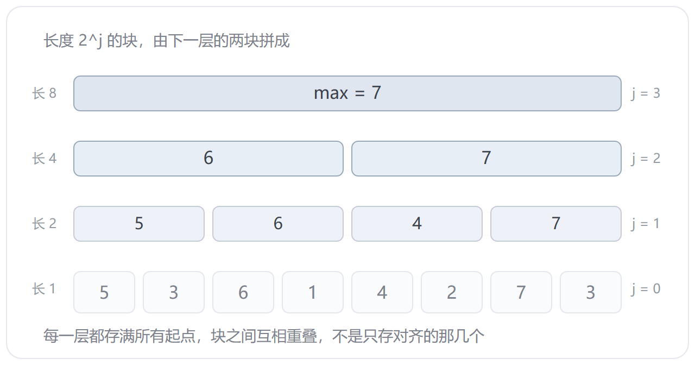

上一篇的单调队列管窗口，前提是窗口得一个个走过去。窗口要是随便给、查询又多，就该 ST 表上场。

它只做一件事，**倍增**：长度 1 的区间拼成 2，2 拼成 4，一路翻上去。查询的时候，随便一个区间都能被两块 2 的幂盖住，多出来的那截重叠，取最值不介意。

## 两份模板

两份只差两个词：转移那行的 `max`，查询那行的 `max`，换成 `min` 就是最小值版。数组、`lg`、边界、循环顺序，一个字都不用动。

下面这份是最大值版，也就是题一 P3865 的答案：

```cpp
#include <iostream>
#include <algorithm>
using namespace std;

const int N = 1e5 + 10;
const int LOG = 17;

int st[N][LOG];
int lg[N];

int main() {
    ios::sync_with_stdio(false);
    cin.tie(nullptr);
    int n, m;
    cin >> n >> m;
    lg[0] = -1;
    for (int i = 1; i <= n; i++) {
        cin >> st[i][0];
        lg[i] = lg[i >> 1] + 1;
    }
    for (int j = 1; j < LOG; j++) {
        int h = 1 << (j - 1);
        for (int i = 1; i + (1 << j) - 1 <= n; i++) {
            st[i][j] = max(st[i][j - 1], st[i + h][j - 1]);
        }
    }
    for (int i = 1; i <= m; i++) {
        int l, r;
        cin >> l >> r;
        int k = lg[r - l + 1], len = 1 << k;
        cout << max(st[l][k], st[r - len + 1][k]) << '\n';
    }
    return 0;
}
```

`lg` 和读入挤在一个循环里，省一遍扫。`lg[0] = -1` 是给 `lg[1]` 铺路的：`lg[1] = lg[0] + 1 = 0`。这个数组算出来的是 `⌊log2 i⌋`，查询里天天用。

`h` 是下面那层的块长，`len` 是这次查询的块长。两个都是 `2` 的幂，写成变量只为少敲几遍 `1 << k`。

`LOG` 取 17 是因为 `n ≤ 1e5`，`⌊log2 1e5⌋ = 16`，层号 0 到 16 正好 17 层。数组一共 `1e5 × 17` 个 `int`，6.8MB，125MB 的限够用。

## 表是怎么搭的

`st[i][j]` 是从 `i` 开始、长度 `2^j` 的区间最值。`j = 0` 就是 `a[i]` 本身，再往上一层，两个相邻的块拼成一个：

`st[i][j] = max(st[i][j-1], st[i + 2^(j-1)][j-1])`

前一半盖 `[i, i + 2^(j-1) - 1]`，后一半从 `i + 2^(j-1)` 起，两段接上正好是 `2^j`。



外面那层循环必须是 `j`，不是 `i`。同一层的块全靠下一层的，第 `j-1` 层没铺满，第 `j` 层就没有东西可拼。这跟一般 DP 按下标推的顺序反着来，是最容易写错的一处。

下面拿 `5 3 6 1 4 2 7 3` 走一遍，每点一下多出来一块：



八个数搭到第 3 层就完了，只有一块，正好是整段。表里一共 `n log n` 个数，块之间还互相重叠，不是只存对齐的那几个。

## 两块盖住一个区间

`len = r - l + 1`，`k = lg[len]`。因为 `2^k ≤ len < 2^(k+1)`，所以两块长 `2^k` 加起来至少 `2 × 2^k ≥ len`，一定盖得住。

左块从 `l` 起，右块贴着 `r` 结束，中间必然有重叠：

![4 + 4 = 8 ≥ 6，两块盖满 [2, 7]，中间两格算了两次](st-cover.png)

`k` 只能往下取整。取成 `⌈log2 len⌉` 的话块比区间还长，右块的起点会落到 `l` 左边，把区间外的数也算了进来；再往左一点就成了负下标。也不用把 `len` 拆成二进制拿三块拼，两块就够，反正重叠不花钱。

重叠不花钱，是因为最值**幂等**：`max(x, x) = x`。换成求和就完了，重叠那几格会被加两遍。这一条决定了 ST 表能管什么：`max`、`min`、`gcd`、按位或、按位与都行，`sum` 不行。

下面换着抽查询，看 `k` 怎么定、两块怎么贴：



四组查询里 `[1, 8]` 和 `[6, 6]` 是特例：`len` 本身就是 2 的幂（或者就是 1），左右两块其实是同一块，压根没重叠。

## 题一：P3865

`n, m ≤ 1e5`，值域到 `1e9`，时限 0.8s。上面那份直接交。

样例 `9 3 1 7 5 6 0 8`，问 `[1, 6]`：`len = 6`，`k = 2`，左块 `[1, 4]` 出 9，右块 `[3, 6]` 出 7，答案 9。八组问完是 `9 9 7 7 9 8 7 9`。

0.8s 的时限看着紧，其实 `1e5` 个数加 `1e5` 次询问，本机 `g++ -O2` 跑完 0.13s，`cin` 关掉同步就够了，快读不是必须的。

## 题二：P5097

洞窟里 `n` 段通道首尾相连，第 `i` 段的阈值是 `a[i]`。贝茜问 `q` 次：从第 `l` 段走到第 `r` 段，体重指数不能超过路上阈值的最小值。裸的区间最小值。

和上面那份逐字比对，只差两处：建表那行的 `max`、查询那行的 `max`，都改成 `min`。其余从 `#include` 到 `return 0` 一个字没动：

```cpp
#include <iostream>
#include <algorithm>
using namespace std;

const int N = 1e5 + 10;
const int LOG = 17;

int st[N][LOG];
int lg[N];

int main() {
    ios::sync_with_stdio(false);
    cin.tie(nullptr);
    int n, m;
    cin >> n >> m;
    lg[0] = -1;
    for (int i = 1; i <= n; i++) {
        cin >> st[i][0];
        lg[i] = lg[i >> 1] + 1;
    }
    for (int j = 1; j < LOG; j++) {
        int h = 1 << (j - 1);
        for (int i = 1; i + (1 << j) - 1 <= n; i++) {
            st[i][j] = min(st[i][j - 1], st[i + h][j - 1]);
        }
    }
    for (int i = 1; i <= m; i++) {
        int l, r;
        cin >> l >> r;
        int k = lg[r - l + 1], len = 1 << k;
        cout << min(st[l][k], st[r - len + 1][k]) << '\n';
    }
    return 0;
}
```

`LOG` 也懒得动：`n ≤ 2.5e4`，`⌊log2 25000⌋ = 14`，17 层照样够。上面那两层 `1 << 15`、`1 << 16` 都超过 `n`，内层条件不成立，一个数都不会填。

样例 `10 4`，阈值是 `75 30 100 38 50 51 52 20 81 5`，一行一个。问 `[3, 5]`：`len = 3`，`k = 1`，两块都长 `2`——左块 `[3, 4]` 出 38，右块 `[4, 5]` 出 38，第 4 段被算了两次，答案还是 38。四问下来是 `5 38 20 5`。

顺带一个细节：题一 `n` 个数挤在一行，这题一行一个，读入一个字都不用改。`cin >>` 按空白切，换行和空格一个待遇。这也是同一份代码能交两道题的原因。

数据小，暴力其实也能过：`n = q = 2.5e4`，全问 `[1, n]` 也就 `6.25e8` 次比较，本机 `g++ -O2` 跑 0.37s。洛谷的机器比本机慢一截，卡在 1s 边上，能过但没余量。所以这题比的不是想不想得到，是敢不敢直接套模板：两处 `max` 换成 `min`，样例对上就交，不用自己另编一套。

上一篇的滑动窗口是「窗口自己一段段走过去」，这题是「别人点名要哪一段」，窗口根本不受你控制。这就是 ST 表的地盘。

## 注意细节

- **`LOG` 要开够**：层数是 `⌊log2 n⌋ + 1`。开小了不报错，`st[i][j]` 读到的是一片 0，答案悄悄变小。
- **`j < LOG` 还是 `j <= LOG`**：第二维只开了 `LOG`，合法下标是 `0` 到 `LOG - 1`，循环上界就得写 `<`。写成 `<=`，`j = LOG` 那轮会去写 `st[i][LOG]`——`1 << LOG` 早就大于 `n`，内层条件不成立才侥幸没写进去；`n` 一旦超过 `2^LOG` 就是实打实的越界。
- **内层边界**：`i + (1 << j) - 1 <= n`，块得整个落在数组里。
- **`lg[0]`**：必须是 `-1`，不然 `lg[1]` 算出来是 1，`k` 全部偏大。也可以用 GCC 的 `__lg`，但那是编译器扩展。
- **运算要幂等**：`max` / `min` / `gcd` / 或 / 与都行，`sum` 不行。这是重叠合法的前提。
- **不支持修改**：改一个点，它往上的每一层都要重算，那就不是 ST 表了，去用线段树。
- **空间**：`n log n`。`1e5` 是 6.8MB，`1e6` 就是 80MB，得掂量。

## 收尾

ST 表和线段树、树状数组的分工可以说清楚了：树状数组管能拆成前缀的（和、异或），线段树管要改的，ST 表管不能改、但查询多到离谱的。

三者的预处理都是 `O(n log n)` 或 `O(n)`，ST 表贵在建表，赢在查询——一次比较就出结果，连循环都没有。

静态查询这一块到这就齐了。再往上走，要么让它能改（线段树、树状数组），要么让它记住历史版本（可持久化）。
